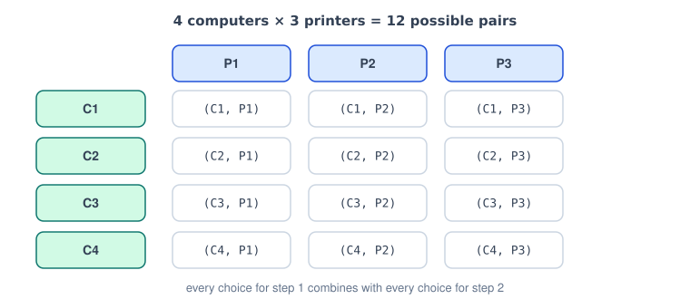
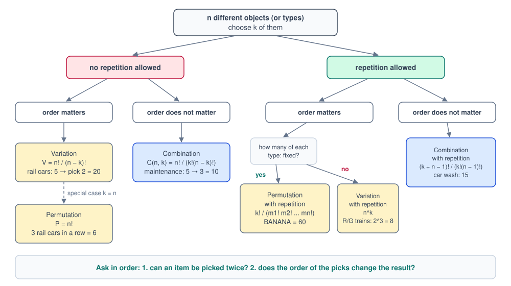
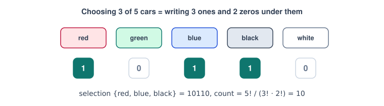
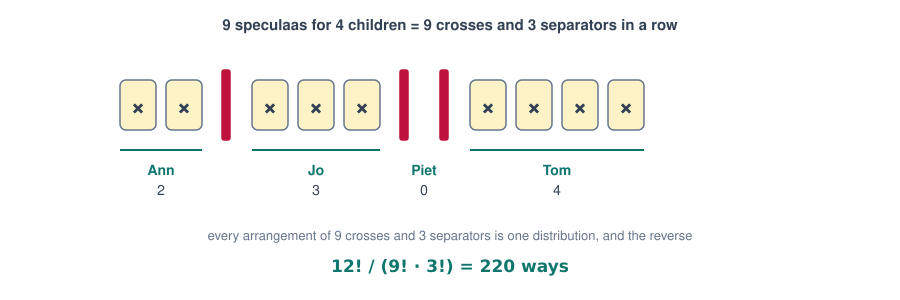

# Combinatorics

Laplace's rule $P(A) = \frac{\#A}{\#\Omega}$ from "Probability Foundations" is easy to state, but counting the favorable and possible outcomes can take a lot of work once the sample space gets large. **Combinatorics** is the toolkit for counting without listing everything. A handful of patterns covers almost every problem, and the skill is recognising which pattern you are looking at.

---

## The Multiplication Principle

Every counting technique in this note is built on one principle. Suppose a store sells 4 computers $C_1, \dots, C_4$ and 3 printers $P_1, P_2, P_3$. How many ways can you buy one computer and one printer? Each computer can be paired with each printer, so there are $4 \cdot 3 = 12$ pairs.



### General Statement

If you build an ordered sequence of $m$ choices, where the first comes from a set with $n_1$ options, the second from a set with $n_2$ options, and so on, the number of possible sequences is

$$n_1 \cdot n_2 \cdot \ldots \cdot n_m$$

The choices do not have to come from the same set, and the number of options at a step may depend on earlier steps, as long as the **count** at each step is fixed. Rolling two dice gives $6 \cdot 6 = 36$ outcomes. Drawing two cards in order gives $52 \cdot 52 = 2704$ outcomes with replacement and $52 \cdot 51 = 2652$ without.

Nested loops are the programming version: two nested `for` loops over 4 and 3 items run the body $4 \cdot 3$ times.

---

## Factorials

The counting formulas use **factorials** everywhere. For a natural number $n$:

$$n! = n \cdot (n-1) \cdot (n-2) \cdot \ldots \cdot 2 \cdot 1, \qquad 0! = 1$$

"$n$ factorial" counts the ways to put $n$ different objects in a row: $n$ choices for the first spot, $n - 1$ for the second, and so on. The definition $0! = 1$ says there is exactly one way to arrange nothing, and it makes the formulas below work at the edges.

| Expression | Value |
|---|---|
| $4!$ | $24$ |
| $5!$ | $120$ |
| $\frac{4!}{2! \cdot 1! \cdot 1!}$ | $12$ |
| $\frac{5!}{3!}$ | $20$ |
| $2^3$ | $8$ |
| $3!$ | $6$ |
| $\frac{5!}{3! \cdot 2!}$ | $10$ |
| $\frac{6!}{4! \cdot 2!}$ | $15$ |

Factorials grow absurdly fast: $20! \approx 2.4 \cdot 10^{18}$ already overflows a signed 64-bit integer. That is the real reason brute-forcing every permutation is hopeless beyond about a dozen items.

---

## The Six Counting Patterns

Every pattern answers the same question, "in how many ways can I choose $k$ items from $n$?", and differs only in two yes/no questions: **can an item be chosen more than once?** and **does the order of the choices matter?** The book's running example is a rail yard in Leuven where trains are built from coloured cars.



### Variations Without Repetition

**Question:** choose $k$ items from $n$ different items, **no repetition**, **order matters**.

**Example:** 5 different cars (red, green, blue, black, white). How many trains of 2 cars can you form, coupling them in the order chosen? The train RG differs from GR.

**Reasoning:** $n$ choices for the first item, $n - 1$ for the second, ..., $n - k + 1$ for the $k$-th. Multiply, then complete it to factorials by multiplying and dividing by $(n - k)!$:

$$V(n, k) = n(n-1)\cdots(n-k+1) = \frac{n!}{(n-k)!}$$

For the trains: $\frac{5!}{3!} = 5 \cdot 4 = 20$. A drama club choosing a president, vice president and secretary from 6 members: $\frac{6!}{3!} = 6 \cdot 5 \cdot 4 = 120$, because the roles are different, so order matters.

### Permutations Without Repetition

**Question:** arrange **all** $n$ different items in a row.

**Example:** 3 cars (red, green, blue), how many orders? RGB, RBG, GRB, GBR, BRG, BGR.

**Reasoning:** this is a variation with $k = n$, and $(n - n)! = 0! = 1$:

$$P(n) = n!$$

So $3! = 6$ trains. Seating 10 people on 10 numbered chairs gives $10! = 3\,628\,800$ arrangements. Around a **round** table where only the relative positions count, fix one person's seat to remove the rotations, leaving $(10 - 1)! = 9! = 362\,880$.

### Variations With Repetition

**Question:** choose $k$ items from $n$ types, **repetition allowed**, **order matters**.

**Example:** red and green cars in unlimited supply. How many trains of 3 cars? RRR, RRG, RGR, RGG, GRR, GRG, GGR, GGG.

**Reasoning:** every one of the $k$ positions independently has all $n$ options:

$$\overline{V}(n, k) = n^k$$

So $2^3 = 8$ trains. A slot machine with 5 reels of 6 symbols each has $6^5 = 7776$ outcomes. A 4-wheel bike lock with digits 1 to 9 has $9^4 = 6561$ combinations (and is a "combination lock" that actually needs a variation formula).

### Permutations With Repetition

**Question:** arrange $k$ items in a row, where $m_1$ are identical of type 1, $m_2$ of type 2, ..., $m_n$ of type $n$, and $k = m_1 + m_2 + \dots + m_n$.

**Example:** 2 identical red cars, 1 blue, 1 green. How many genuinely different trains?

**Reasoning:** pretend all items are distinct, giving $k!$ orders. But swapping the $m_1$ identical items among themselves gives the same train, and there are $m_1!$ such swaps. So every real arrangement was counted $m_1!$ times: divide by $m_1!$. Do the same for every type:

$$\overline{P}(k; m_1, \dots, m_n) = \frac{k!}{m_1! \cdot m_2! \cdot \ldots \cdot m_n!}$$

So $\frac{4!}{2! \cdot 1! \cdot 1!} = 12$ trains. The anagrams of BANANA (3 a's, 2 n's, 1 b): $\frac{6!}{3! \cdot 2! \cdot 1!} = 60$. A first aid weekend with 3 hours of first aid, 1 of anatomy, 2 of transport and 2 of bandaging can be scheduled in $\frac{8!}{3! \cdot 1! \cdot 2! \cdot 2!} = 1680$ ways.

### Combinations Without Repetition

**Question:** choose $k$ items from $n$ different items, **no repetition**, **order does not matter**. The result is a **group**, not a sequence.

**Example:** 5 cars, money for maintenance on only 3. How many groups of 3? $\{R, G, B\}$ is the same group as $\{B, G, R\}$.

**Reasoning:** write a $1$ under every chosen item and a $0$ under the others. Each selection becomes a string of $k$ ones and $n - k$ zeros, and every such string is exactly one selection. So count the arrangements of $k$ ones and $n - k$ zeros, which is a permutation with repetition:



$$C(n, k) = \binom{n}{k} = \frac{n!}{k!\,(n-k)!}$$

The symbol $\binom{n}{k}$ is read "$n$ choose $k$" and is called a **binomial coefficient**. For the cars: $\binom{5}{3} = 10$. A mother buying 8 different comics out of a series of 20: $\binom{20}{8} = 125\,970$.

Another way to see it: there are $\frac{n!}{(n-k)!}$ ordered selections, and each unordered group appears in $k!$ orders, so divide by $k!$. Combinations are variations with the order "forgotten".

### Combinations With Repetition

**Question:** choose $k$ items from $n$ types, **repetition allowed**, **order does not matter**.

**Example:** yellow, red and black cars must go through the wash in groups of 4. How many different groups? $\{Y, Y, Y, B\}$ is allowed, and a colour may be missing entirely.

**Reasoning (stars and bars):** represent a selection as $k$ crosses (the items) and $n - 1$ separators (the walls between the types). $\times\times\times\times \mid \times \mid \times\times$ means 4 of type 1, 1 of type 2 and 2 of type 3. Every arrangement of $k$ crosses and $n - 1$ separators is one selection, and every selection is one arrangement. Count arrangements of $k + n - 1$ symbols with $k$ identical crosses and $n - 1$ identical separators:

$$\overline{C}(n, k) = \frac{(k + n - 1)!}{k!\,(n-1)!} = \binom{k + n - 1}{k}$$

For the car wash: $\frac{6!}{4! \cdot 2!} = 15$. Saint Nicholas sharing 9 identical speculaas among 4 children: $\binom{12}{3} = 220$.



---

## Summary Of Formulas

| Pattern | Repetition | Order matters | Formula |
|---|---|---|---|
| Variation | No | Yes | $\frac{n!}{(n-k)!}$ |
| Permutation | No | Yes, all $n$ items | $n!$ |
| Variation with repetition | Yes | Yes | $n^k$ |
| Permutation with repetition | Fixed counts $m_i$ per type | Yes | $\frac{k!}{m_1! \cdots m_n!}$ |
| Combination | No | No | $\binom{n}{k} = \frac{n!}{k!(n-k)!}$ |
| Combination with repetition | Yes | No | $\frac{(k+n-1)!}{k!(n-1)!}$ |

The distinction between the two "repetition, order matters" rows: in a **variation with repetition** you decide freely at every position how many of each type you use. In a **permutation with repetition** the number of each type is **fixed in advance** and you only decide where they go.

### Python Checks

Python's standard library has these built in, and `itertools` can brute force small cases to confirm a formula. Brute forcing a small version of the problem is the best way to check a formula you are unsure about.

```python
from math import comb, perm, factorial
from itertools import permutations, combinations, product, combinations_with_replacement

print(perm(5, 2), len(list(permutations("RGBKW", 2))))                     # 20 20
print(comb(5, 3), len(list(combinations("RGBKW", 3))))                     # 10 10
print(2**3, len(list(product("RG", repeat=3))))                            # 8 8
print(comb(6, 4), len(list(combinations_with_replacement("YRB", 4))))     # 15 15
print(factorial(6) // (factorial(3) * factorial(2)), len(set(permutations("BANANA"))))  # 60 60
```

---

## Worked Exercises

The trick in every exercise is to answer the two questions (repetition? order?) before reaching for a formula, and to split complicated problems into steps joined by the multiplication principle.

### Warm Up

Socks and shoes: 3 pairs of socks and 2 pairs of shoes give $3 \cdot 2 = 6$ outfits.

A flag of 3 horizontal stripes from 4 colours, no two adjacent stripes the same: $4 \cdot 3 \cdot 3 = 36$. The bottom stripe only has to differ from the middle one, so it has 3 options again.

Covering 3 books with 5 types of paper, each book a different type: $5 \cdot 4 \cdot 3 = 60$.

8-digit numbers using four 1s, three 2s and one 3: $\frac{8!}{4!\,3!\,1!} = 280$.

### Groups And Committees

A folk dance group of 24 people (8 boys, 16 girls). A committee of 6: $\binom{24}{6} = 134\,596$. A representative committee of 2 boys and 4 girls: $\binom{8}{2}\binom{16}{4} = 28 \cdot 1820 = 50\,960$. Two independent choices, joined by the multiplication principle.

Dividing a class of 24 into three **labelled** groups of 8 (each group gets a different exam): $\binom{24}{8}\binom{16}{8}\binom{8}{8} = \frac{24!}{(8!)^3}$.

Twelve scouts split into two **unlabelled** teams of 6: $\frac{1}{2}\binom{12}{6} = 462$. Dividing by $2$ removes the double count, because choosing team $X$ automatically fixes team $Y$, and $\{X, Y\}$ is the same split as $\{Y, X\}$. Into four unlabelled groups of 3: $\frac{12!}{(3!)^4 \cdot 4!} = 15\,400$.

### Seating

Five couples around a round table, each couple sitting together. Glue each couple into one block: $(5 - 1)!$ circular orders of blocks, and each block can sit in 2 orders: $4! \cdot 2^5 = 768$.

### The Leading Zero Trap

How many five-digit numbers with distinct digits contain exactly 2 even and 3 odd digits, with no leading $0$? Split on whether $0$ is used.

- Without $0$: choose 2 evens from $\{2, 4, 6, 8\}$ and 3 odds from 5, then arrange: $\binom{4}{2}\binom{5}{3} \cdot 5! = 60 \cdot 120 = 7200$.
- With $0$: choose 1 more even and 3 odds, arrange, then subtract arrangements starting with $0$: $\binom{4}{1}\binom{5}{3} \cdot (5! - 4!) = 40 \cdot 96 = 3840$.

Total: $7200 + 3840 = 11\,040$.

### Poker Hands

A 5-card hand from 52 cards: $\binom{52}{5} = 2\,598\,960$. Count special hands by choosing **ranks** first, then **suits**:

| Hand | Count | Reasoning |
|---|---|---|
| Four of a kind | $13 \cdot 48 = 624$ | rank of the four, then any of the 48 other cards |
| Full house | $13\binom{4}{3} \cdot 12\binom{4}{2} = 3744$ | rank and suits of the triple, then of the pair |
| Two pair | $\binom{13}{2}\binom{4}{2}^2 \cdot 11 \cdot 4 = 123\,552$ | two pair ranks (unordered), their suits, then the fifth card |

### Computer Science Applications

8-character passwords from 26 uppercase letters and 10 digits: $36^8 \approx 2.8 \cdot 10^{12}$. With **at least one digit**, use the complement: $36^8 - 26^8 = 2\,612\,282\,842\,880$.

Binary strings of length 16: $2^{16} = 65\,536$. With exactly 5 ones: $\binom{16}{5} = 4368$. With at least one 1: $2^{16} - 1$.

IPv4 addresses (four numbers from 0 to 255): $256^4 = 2^{32} = 4\,294\,967\,296$. Those starting with 192: $256^3$, which is $\frac{1}{256} \approx 0.39\%$ of all addresses.

Execution orders of 8 tasks: $8! = 40\,320$. If task A must run before task B: by symmetry, exactly half of all orders have A first, so $\frac{8!}{2} = 20\,160$.

An 8-character hexadecimal hash has $16^8 = 2^{32}$ values, so a random hash equals `1A2B3C4D` with probability $\frac{1}{16^8}$.

Assigning the four different roles web, database, mail and backup to 4 of 12 servers (order matters, roles differ): $\frac{12!}{8!} = 11\,880$. Just choosing 4 servers for maintenance (no roles): $\binom{12}{4} = 495$.

Choosing 30 of 40 examples for a training set: $\binom{40}{30} = \binom{40}{10} = 847\,660\,528$. Once the training set is fixed, the test set is determined, so there is only $1$ way left. In general $\binom{n}{k} = \binom{n}{n-k}$: choosing what goes in is the same as choosing what stays out.

---

## Quick Recap

- **Multiplication principle**: independent steps multiply, $n_1 \cdot n_2 \cdots n_m$.
- **Factorial** $n!$ counts orders of $n$ distinct items; $0! = 1$.
- Ask two questions: **repetition allowed?** and **order matters?**
- No repetition: **variation** $\frac{n!}{(n-k)!}$, **permutation** $n!$, **combination** $\binom{n}{k}$.
- With repetition: **variation** $n^k$, **permutation with fixed counts** $\frac{k!}{m_1!\cdots m_n!}$, **combination** $\binom{k+n-1}{k}$ (stars and bars).
- Combination = variation with the $k!$ orders divided out.
- Use the **complement** for "at least one", **split into cases** for awkward constraints (leading zero), and **divide out** double counts for unlabelled groups.
