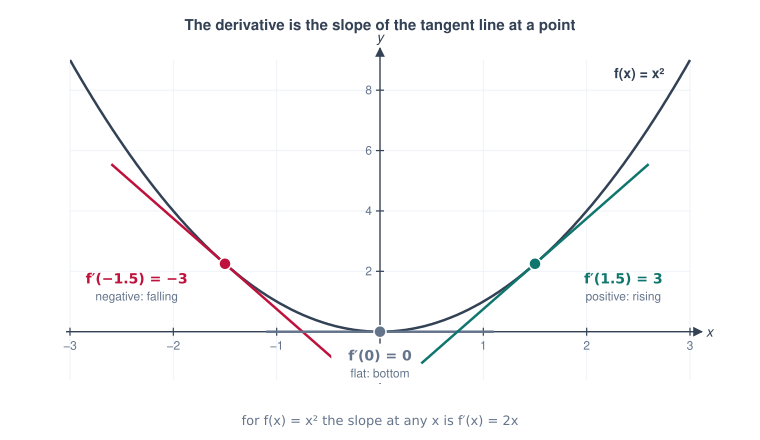
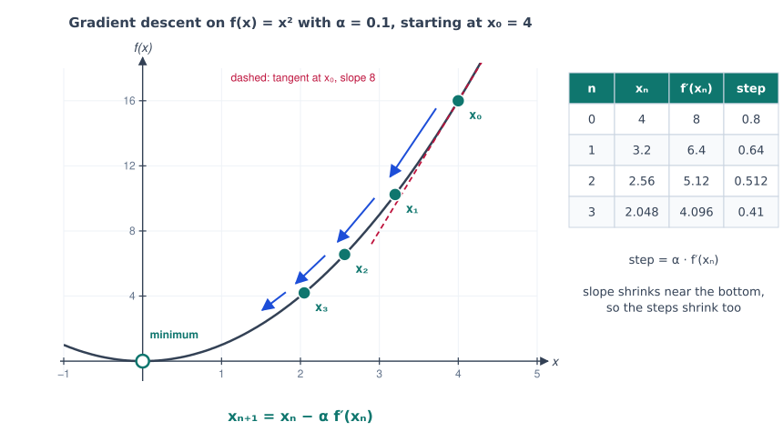
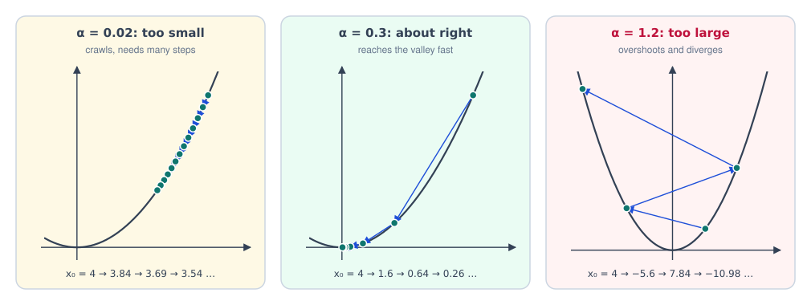
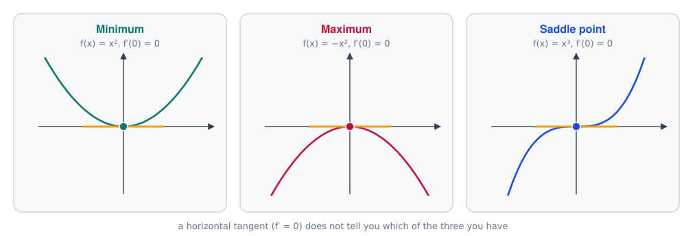
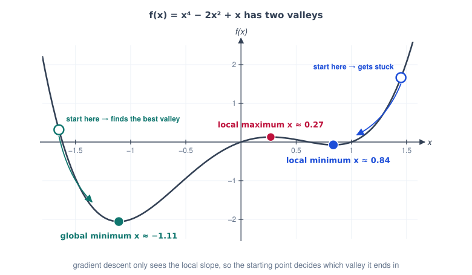

# Derivatives And Gradient Descent

**Calculus** is the branch of mathematics that studies **continuous change**. It has two main branches: **differential calculus**, which studies rates of change, and **integral calculus**, which studies accumulation and area. This note covers the first branch and its most important application in computer science, **gradient descent**, the optimization algorithm behind almost all of modern machine learning. Integrals are in "Integrals."

---

## What A Derivative Is

The **derivative** of a function measures how quickly the function changes. If $y = f(x)$, the derivative is written $f'(x)$ (Lagrange notation, "f prime") or $\frac{dy}{dx}$ (Leibniz notation, "a small change in $y$ per small change in $x$").

Geometrically, the derivative at a point is the **slope of the tangent line** to the graph at that point. The tangent is the straight line that just touches the curve there and points in the direction the curve is heading.



### Reading The Sign

The sign of the derivative tells you the direction of the function, and its size tells you how steep it is.

| Derivative | Function is | Picture |
|---|---|---|
| $f'(x) > 0$ | **Increasing** | Walking uphill |
| $f'(x) < 0$ | **Decreasing** | Walking downhill |
| $f'(x) = 0$ | Momentarily **flat** | Top of a hill, bottom of a valley, or a plateau |

A speedometer is a good analogy. Your position on the road is $f(t)$, and the speedometer shows $f'(t)$: not where you are, but how fast where you are is changing.

---

## Differentiation Rules

You rarely compute derivatives from the formal limit definition. Instead you apply a small set of rules, term by term.

### The Power Rule

The most important rule, used for every **polynomial** (an expression built from powers of $x$, like $3x^3 - 2x + 1$):

$$\frac{d}{dx}\left(x^n\right) = n\,x^{n-1}$$

Bring the exponent down in front, then lower the exponent by one.

$$\frac{d}{dx}(x^2) = 2x \qquad \frac{d}{dx}(x^3) = 3x^2 \qquad \frac{d}{dx}(x^5) = 5x^4$$

### Constants And Constant Multiples

A **constant** does not change, so its rate of change is zero: $\frac{d}{dx}(7) = 0$. A **constant multiple** just comes along for the ride:

$$\frac{d}{dx}(5x^3) = 5 \cdot \frac{d}{dx}(x^3) = 5 \cdot 3x^2 = 15x^2$$

A term like $2x$ is $2x^1$, so its derivative is $2 \cdot 1 \cdot x^0 = 2$.

### Sums Term By Term

The derivative of a sum is the sum of the derivatives, so you differentiate each term separately:

$$f(x) = 3x^2 + 2x + 1 \quad\Rightarrow\quad f'(x) = 6x + 2 + 0 = 6x + 2$$

### Exponential Functions

An **exponential function** has the variable in the **exponent**, such as $2^x$, $3^x$ or $e^x$. The most important one uses **Euler's number** $e \approx 2.71828$, because $e^x$ has a remarkable property: it is its **own derivative**.

$$\frac{d}{dx}\left(e^x\right) = e^x \qquad \frac{d}{dx}\left(5e^x\right) = 5e^x \qquad \frac{d}{dx}\left(e^{kx}\right) = k\,e^{kx}$$

The last rule is a special case of the **chain rule**: the constant $k$ in the exponent comes out in front. So $\frac{d}{dx}(e^{2x}) = 2e^{2x}$ and $\frac{d}{dx}(7e^{2x}) = 14e^{2x}$. The meaning of $e^x = (e^x)'$ is that the growth rate is always equal to the current size, which is exactly the behaviour of compound interest, viral spread and unchecked population growth.

### Rules Summary

| Function | Derivative |
|---|---|
| $c$ (constant) | $0$ |
| $x^n$ | $n x^{n-1}$ |
| $c \cdot f(x)$ | $c \cdot f'(x)$ |
| $f(x) + g(x)$ | $f'(x) + g'(x)$ |
| $e^x$ | $e^x$ |
| $e^{kx}$ | $k e^{kx}$ |

### Higher Derivatives

A derivative is itself a function, so you can differentiate it again. For $f(x) = x^3$:

$$f'(x) = 3x^2 \qquad f''(x) = 6x \qquad f'''(x) = 6$$

The **second derivative** $f''$ measures how the rate of change itself changes. In physics, if $h(t)$ is position, $h'(t)$ is velocity and $h''(t)$ is acceleration. In optimisation, $f''$ tells you whether a flat point is a valley ($f'' > 0$) or a hilltop ($f'' < 0$).

---

## Applications In Computer Science

Whenever you want to understand how one quantity responds to another, derivatives show up.

### Machine Learning

A model with a parameter $w$ is judged by a **loss function** $L(w)$ that measures how wrong its predictions are. The derivative $L'(w)$ says how the loss changes when you nudge $w$. Training a model means repeatedly moving $w$ in the direction that lowers the loss, which is gradient descent, covered in detail below:

$$w_{\text{new}} = w_{\text{old}} - \alpha\,L'(w_{\text{old}})$$

### Algorithm Analysis

If an algorithm's running time is approximately $T(n) = n^2$, then $T'(n) = 2n$ describes how quickly the running time grows as the input grows. Big O notation such as $O(n^2)$ captures the long-term growth class, while the derivative gives the instantaneous growth rate. For $T(n) = n^3$, $T'(n) = 3n^2$: adding one element to a big input costs roughly $3n^2$ extra steps.

### Computer Graphics

The derivative of a curve gives its slope at every point, and that slope determines the **surface normal**, the direction perpendicular to the surface. Normals are what lighting, reflections and shading calculations are built on.

### Network Traffic And User Growth

If $P(t)$ is the number of packets transmitted at time $t$, then $P'(t)$ is the rate of change of traffic. A large positive spike may signal a sudden surge, a large negative one may signal congestion or a failure.

For a website whose users grow as $U(t) = 1000e^{0.2t}$, the growth rate is $U'(t) = 200e^{0.2t}$. Notice that the rate is $0.2$ times the current number of users: the more users you have, the faster you gain new ones. Even when libraries compute derivatives for you (PyTorch's `autograd`, for example), knowing what they mean is what lets you reason about why a model trains or fails to train.

---

## Gradient Descent

**Gradient descent** is an iterative optimisation algorithm: it searches for the input that **minimises** a function, using only the derivative. Take $f(x) = x^2$. You can see that the minimum is at $x = 0$ where $f(0) = 0$, but for a loss function with millions of parameters you cannot see anything, so you need an algorithm.

### The Blindfolded Hiker

Imagine standing on a mountain, blindfolded, trying to reach the bottom of the valley. A reasonable strategy is:

1. Feel the slope of the ground under your feet.
2. Take a small step **downhill**.
3. Repeat until the ground is flat.

The derivative is the slope you feel. A **positive** derivative means uphill is to the right, so you step **left**. A **negative** derivative means uphill is to the left, so you step **right**. In both cases you move in the direction **opposite** to the derivative.

### The Update Rule

From the current position $x_n$, the next position is

$$x_{n+1} = x_n - \alpha\,f'(x_n)$$

where $f'(x_n)$ is the slope at the current point and $\alpha$ is the **learning rate**, the step size multiplier. The minus sign is the "opposite direction" from the hiker strategy.

### Worked Example

Minimise $f(x) = x^2$, with $f'(x) = 2x$, starting at $x_0 = 4$ with $\alpha = 0.1$. The update rule becomes $x_{n+1} = x_n - 0.1 \cdot 2x_n = 0.8\,x_n$.

$$x_1 = 4 - 0.1(8) = 3.2 \qquad x_2 = 3.2 - 0.1(6.4) = 2.56 \qquad x_3 = 2.56 - 0.1(5.12) = 2.048$$

$$4 \to 3.2 \to 2.56 \to 2.048 \to \cdots \to 0$$



Look at the step sizes: $0.8$, then $0.64$, then $0.512$. At $x_0 = 4$ the tangent is steep ($f'(4) = 8$) so the step is big. Closer to the bottom the slope flattens and the steps shrink automatically. You do not need to tell the algorithm to slow down near the minimum, the derivative does it for you.

The same thing in code takes only a few lines:

```python
def gradient_descent(df, x0, alpha=0.1, steps=50, tol=1e-8):
    x = x0
    for n in range(steps):
        step = alpha * df(x)
        x = x - step
        if abs(step) < tol:          # slope is (almost) zero: converged
            break
    return x

df = lambda x: 2 * x                 # derivative of f(x) = x**2
print(gradient_descent(df, x0=4))    # very close to 0
```

### Choosing The Learning Rate

The learning rate is the most important setting of the algorithm, and it is a trade-off.



| Learning rate | Behaviour |
|---|---|
| **Too small** | Converges, but painfully slowly: many tiny steps |
| **About right** | Converges quickly to the minimum |
| **Too large** | Jumps over the minimum, oscillates, and can even diverge |

With $\alpha = 1.2$ on $x^2$ the update becomes $x_{n+1} = x_n - 2.4x_n = -1.4x_n$. Each step flips the sign and multiplies the distance by $1.4$: $4 \to -5.6 \to 7.84 \to -10.976$. The algorithm overshoots further every time and never settles. For $f(x) = x^2$ specifically, the update is $x_{n+1} = (1 - 2\alpha)x_n$, so it converges exactly when $|1 - 2\alpha| < 1$, meaning $0 < \alpha < 1$.

### Critical Points

When $f'(x_n) = 0$, the update rule gives $x_{n+1} = x_n$: the algorithm stops moving. Such a point is a **critical point**, and it is not necessarily a minimum.



| Type | Example | Second derivative test |
|---|---|---|
| **Minimum** | $x^2$ at $0$ | $f''(0) = 2 > 0$, curves upward |
| **Maximum** | $-x^2$ at $0$ | $f''(0) = -2 < 0$, curves downward |
| **Saddle point** | $x^3$ at $0$ | $f''(0) = 0$, test is inconclusive |

For $x^3$, the function is negative just left of $0$ and positive just right of it, so $0$ is neither a minimum nor a maximum, even though the tangent is horizontal there. So $f'(x) = 0$ is **necessary** for a minimum but not **sufficient**. Gradient descent on $x^3$ can grind to a halt at the saddle point without ever finding a minimum (there is none, the function goes to $-\infty$).

### Local And Global Minima

A function can have several valleys. The lowest one is the **global minimum**, the others are **local minima**. Gradient descent only ever feels the local slope, so it settles in whichever valley it starts above.



For $f(x) = x^4 - 2x^2 + x$, the derivative $f'(x) = 4x^3 - 4x + 1$ has three zeros (found numerically): $x \approx -1.11$ (global minimum, $f \approx -2.06$), $x \approx 0.27$ (local maximum) and $x \approx 0.84$ (local minimum, $f \approx -0.07$). Start at $x_0 = 1.5$ and the algorithm happily stops at $0.84$, unaware that a much deeper valley exists. In practice this is handled with tricks like random restarts, momentum, or stochastic noise in the gradient.

### Gradient Descent In Machine Learning

Real models have many parameters, the **weights** $w_1, w_2, \dots, w_n$, and a loss that depends on all of them, $L(w_1, \dots, w_n)$. For regression, a common loss is the **Mean Squared Error**:

$$L = \frac{1}{N}\sum_{i=1}^{N}\left(y_i - \hat{y}_i\right)^2$$

where $y_i$ is the true value and $\hat{y}_i$ the model's prediction. With several variables, the ordinary derivative is replaced by **partial derivatives** $\frac{\partial L}{\partial w_i}$: the slope in the direction of one weight while the others are held fixed. Together they form the **gradient**, which gives the algorithm its name. Every weight gets the same update rule:

$$w_i \leftarrow w_i - \alpha\,\frac{\partial L}{\partial w_i}$$

This is repeated until the loss is small enough. The same loop trains linear and logistic regression, neural networks, deep learning models and reinforcement learning agents.

---

## Worked Exercises

These cover rules, critical points and gradient descent.

### Rules

$\frac{d}{dx}(7x^3) = 21x^2$. $\frac{d}{dx}(4x^4 - x^2) = 16x^3 - 2x$. $\frac{d}{dx}(2x^5 + 7) = 10x^4$. $\frac{d}{dx}(e^{3x}) = 3e^{3x}$. For $f(x) = x^4$: $f'(x) = 4x^3$ and $f''(x) = 12x^2$.

### Applied Derivatives

Users after $t$ months: $U(t) = 500e^{0.1t}$, so $U'(t) = 50e^{0.1t}$ users per month. Height of a simulated object $h(t) = t^2 + 2t$, so the velocity is $h'(t) = 2t + 2$.

### Critical Points

For $f(x) = x^2 - 4x + 3$: $f'(x) = 2x - 4 = 0 \Rightarrow x = 2$, and $f''(2) = 2 > 0$, so it is a minimum.

For $f(x) = x^4 - 4x^2$: $f'(x) = 4x^3 - 8x = 4x(x^2 - 2) = 0$ gives $x = 0$ and $x = \pm\sqrt{2}$. With $f''(x) = 12x^2 - 8$: $f''(0) = -8 < 0$ (local maximum) and $f''(\pm\sqrt{2}) = 16 > 0$ (both local minima, $f = -4$). Gradient descent started at negative $x$ ends at $-\sqrt{2}$, started at positive $x$ ends at $+\sqrt{2}$.

### One Gradient Descent Step

$f(x) = x^2$, $\alpha = 0.1$, $x_0 = 5$: $f'(5) = 10$, so $x_1 = 5 - 0.1 \cdot 10 = 4$.

---

## Quick Recap

- The **derivative** $f'(x) = \frac{dy}{dx}$ is the **slope of the tangent**: positive means increasing, negative means decreasing, zero means flat.
- **Power rule** $\frac{d}{dx}x^n = nx^{n-1}$, constants vanish, constant multiples stay, sums go term by term.
- $\frac{d}{dx}e^x = e^x$ and $\frac{d}{dx}e^{kx} = ke^{kx}$: exponential growth rate is proportional to the current size.
- **Higher derivatives**: $f''$ is the rate of change of the rate of change (acceleration, curvature).
- **Gradient descent**: $x_{n+1} = x_n - \alpha f'(x_n)$, step opposite to the slope. Steps shrink automatically near the minimum.
- **Learning rate**: too small is slow, too large overshoots or diverges.
- $f'(x) = 0$ marks a **critical point**: minimum, maximum or saddle. Use $f''$ to classify.
- Gradient descent can get stuck in a **local minimum**; the start point matters.
- In ML, the loss (e.g. **MSE**) is minimised with **partial derivatives** for every weight.
