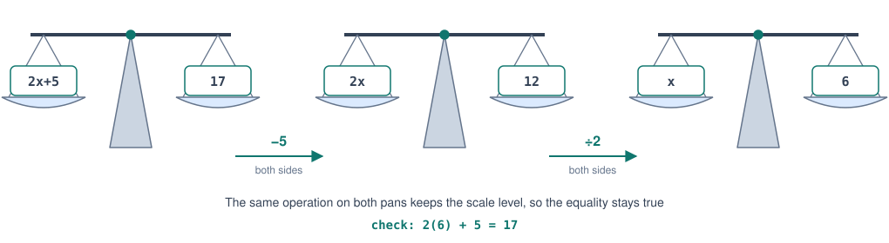
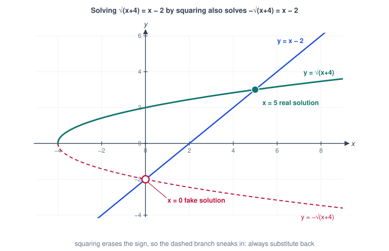

# Equations

An **equation** is a statement that two expressions are equal. $2 + 3 = 5$ is an equation with no unknowns, while $x + 3 = 7$ contains a **variable**, an unknown number we want to find. **Solving** an equation means finding every value of the variable that makes the statement true. This note relies on the operations from "Numbers & Arithmetic".

---

## The Balance Principle

Every technique for solving equations comes from one idea: an equation is a **balance scale**. Whatever you do to one side, you must do to the other, and the scale stays level.



Formally, if $a = b$, then $a + c = b + c$, $a - c = b - c$, $a \cdot c = b \cdot c$, and $\frac{a}{c} = \frac{b}{c}$ for any $c \neq 0$. The restriction on division matters: dividing both sides by $0$ is not allowed, and dividing both sides by an expression that might be $0$ can silently lose solutions.

### Isolate The Variable

The goal is always to get the variable **alone** on one side. To do that, undo the operations applied to it in **reverse order**, like unwrapping a present: the last layer put on comes off first. In $2x + 5$, the $x$ was first multiplied by $2$ and then $5$ was added, so you first subtract $5$ and then divide by $2$.

| Operation on $x$ | Undo it with | Example | Solution |
|---|---|---|---|
| $+3$ | $-3$ on both sides | $x + 3 = 7$ | $x = 4$ |
| $-5$ | $+5$ on both sides | $x - 5 = 12$ | $x = 17$ |
| $\cdot 3$ | $\div 3$ on both sides | $3x = 18$ | $x = 6$ |
| $\div 4$ | $\cdot 4$ on both sides | $\frac{x}{4} = 5$ | $x = 20$ |

---

## Solving Linear Equations

A **linear equation** in one variable has the variable only to the power $1$. Most need several steps, and you can solve them mechanically with the reverse-order rule.

### Multi Step Example

Solve $2x + 5 = 17$.

$$2x + 5 = 17 \;\xrightarrow{-5}\; 2x = 12 \;\xrightarrow{\div 2}\; x = 6$$

### Always Check

**Substitute** your answer into the **original** equation. It takes ten seconds and catches most mistakes:

$$2(6) + 5 = 12 + 5 = 17 \checkmark$$

### Equations With Fractions

When the variable is divided by a number, treat the division like any other operation. Solve $\frac{x}{3} + 2 = 7$: subtract $2$ to get $\frac{x}{3} = 5$, then multiply by $3$ to get $x = 15$. Check: $\frac{15}{3} + 2 = 5 + 2 = 7$.

### Translating Words Into Equations

"A number increased by 7 equals 18" becomes $x + 7 = 18$, so $x = 11$. The translation is the real skill: "increased by" is $+$, "times" is $\cdot$, "is" or "equals" is $=$.

### Common Mistakes In Linear Equations

| Mistake | Wrong | Right |
|---|---|---|
| Operating on one side only | $x + 4 = 10 - 4$ | $x + 4 - 4 = 10 - 4$, so $x = 6$ |
| Incomplete distribution | $2(x + 3) = 2x + 3$ | $2(x + 3) = 2x + 6$ |
| Skipping the check | trusting the first answer | substitute back into the original |

---

## Equations With Powers

To undo a power, take the matching **root** of both sides. The catch is that **even** powers lose the sign information, so there can be two solutions.

### Even Powers Give Two Answers

Both $7^2$ and $(-7)^2$ equal $49$, so

$$x^2 = 49 \Rightarrow x = \pm\sqrt{49} = \pm 7$$

Forgetting the $\pm$ is one of the most common mistakes. If $x$ represents something that cannot be negative, like a length, you discard the negative root afterwards, but you have to make that decision consciously.

### Odd Powers Give One Answer

An odd power keeps the sign, so there is exactly one real solution:

$$x^3 = 27 \Rightarrow x = \sqrt[3]{27} = 3 \qquad\qquad x^3 = -8 \Rightarrow x = -2$$

---

## Equations With Roots

To undo a root, raise both sides to the matching **power**. Squaring removes a square root:

$$\sqrt{x} = 5 \Rightarrow (\sqrt{x})^2 = 5^2 \Rightarrow x = 25$$

$$\sqrt{x + 1} = 4 \Rightarrow x + 1 = 16 \Rightarrow x = 15$$

$$\sqrt{x - 4} = 3 \Rightarrow x - 4 = 9 \Rightarrow x = 13$$

### Rational Exponents

A rational exponent is a root in disguise, so undo it by raising both sides to the **reciprocal** exponent. This works because $(x^{\frac{m}{n}})^{\frac{n}{m}} = x^1 = x$ by the power of a power rule.

| Equation | Raise both sides to | Result |
|---|---|---|
| $x^{\frac{1}{2}} = 3$ | $2$ | $x = 9$ |
| $x^{\frac{1}{3}} = 2$ | $3$ | $x = 8$ |
| $x^{\frac{2}{3}} = 4$ | $\frac{3}{2}$ | $x = 4^{\frac{3}{2}} = (\sqrt{4})^3 = 8$ |

Strictly, $x^{\frac{2}{3}} = 4$ also has the solution $x = -8$, because $(-8)^{\frac{2}{3}} = (\sqrt[3]{-8})^2 = (-2)^2 = 4$. The even numerator hides the sign, just like $x^2$ does. Courses often restrict rational exponents to $x \geq 0$, which removes this case.

---

## Extraneous Solutions

**Squaring both sides is not a reversible step.** If $a = b$ then $a^2 = b^2$, but $a^2 = b^2$ only tells you $a = \pm b$. So squaring can introduce **extraneous** (fake) solutions that satisfy the squared equation but not the original one. Whenever you square to remove a radical, you **must** check every candidate in the original equation.

### Worked Example

Solve $\sqrt{x + 4} = x - 2$.

A square root is never negative, so the right side must satisfy $x - 2 \geq 0$, meaning $x \geq 2$. Now square both sides:

$$x + 4 = (x - 2)^2 = x^2 - 4x + 4$$

$$0 = x^2 - 5x = x(x - 5) \Rightarrow x = 0 \text{ or } x = 5$$

Check both candidates in the original equation:

| Candidate | Left $\sqrt{x+4}$ | Right $x - 2$ | Valid? |
|---|---|---|---|
| $x = 0$ | $\sqrt{4} = 2$ | $-2$ | No, extraneous |
| $x = 5$ | $\sqrt{9} = 3$ | $3$ | Yes |

So the only solution is $x = 5$. The graph shows where the fake one comes from: squaring also solves $-\sqrt{x+4} = x - 2$, the mirrored branch.



### Checking Solutions In Code

A quick numerical check is the programmer's version of substituting back. Floating point needs a tolerance instead of `==`.

```python
import math

def lhs(x): return math.sqrt(x + 4)
def rhs(x): return x - 2

for candidate in (0, 5):
    ok = math.isclose(lhs(candidate), rhs(candidate))
    print(candidate, lhs(candidate), rhs(candidate), "valid" if ok else "extraneous")
```

The same method solves $\sqrt{x + 9} = x - 3$: the condition is $x \geq 3$, squaring gives $x^2 - 7x = 0$, candidates are $x = 0$ (fails, $3 \neq -3$) and $x = 7$ (works, $4 = 4$).

---

## Worked Exercises

These exercises follow the order of the topics above.

### Linear

$4x - 5 = 19 \Rightarrow 4x = 24 \Rightarrow x = 6$. $\frac{x}{10} = 3 \Rightarrow x = 30$. $\frac{x}{4} + 1 = 6 \Rightarrow \frac{x}{4} = 5 \Rightarrow x = 20$. $\frac{x}{2} - 3 = 7 \Rightarrow \frac{x}{2} = 10 \Rightarrow x = 20$.

### Powers And Roots

$x^2 = 100 \Rightarrow x = \pm 10$. $x^3 = 125 \Rightarrow x = 5$. $\sqrt{2x} = 8 \Rightarrow 2x = 64 \Rightarrow x = 32$. $\sqrt{x + 2} = 7 \Rightarrow x = 47$. $\sqrt{3x} = 9 \Rightarrow 3x = 81 \Rightarrow x = 27$.

### Rational Exponents

$x^{\frac{1}{4}} = 2 \Rightarrow x = 2^4 = 16$. $x^{\frac{2}{3}} = 9 \Rightarrow x = 9^{\frac{3}{2}} = (\sqrt{9})^3 = 27$ (and $x = -27$ if negative $x$ is allowed).

### Applied

A rectangle has length $\frac{1}{2}$ cm and width $\frac{5}{2}$ cm. The perimeter is $2(\frac{1}{2} + \frac{5}{2}) = 2 \cdot 3 = 6$ cm, and the area is $\frac{1}{2} \cdot \frac{5}{2} = \frac{5}{4}$ cm².

---

## Quick Recap

- An equation is a **balance**: apply the same operation to both sides (never divide by $0$).
- **Isolate** the variable by undoing operations in **reverse order**.
- **Always check** by substituting into the original equation.
- **Even powers** give $\pm$ solutions, **odd powers** give one.
- Undo a root by raising to its power, undo $x^{\frac{m}{n}}$ by raising to $\frac{n}{m}$.
- **Squaring is not reversible**: it can create **extraneous solutions**, so checking is mandatory for radical equations. Use the sign condition (a root is $\geq 0$) to reject candidates quickly.
