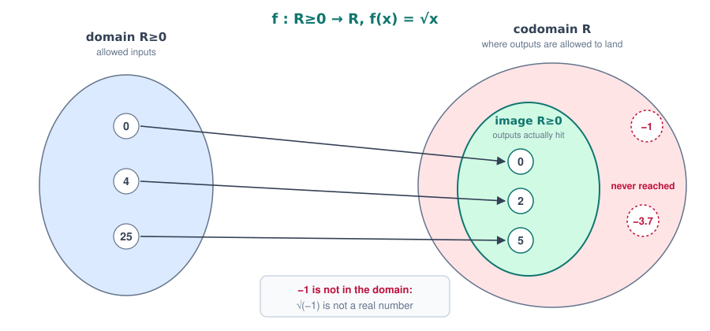
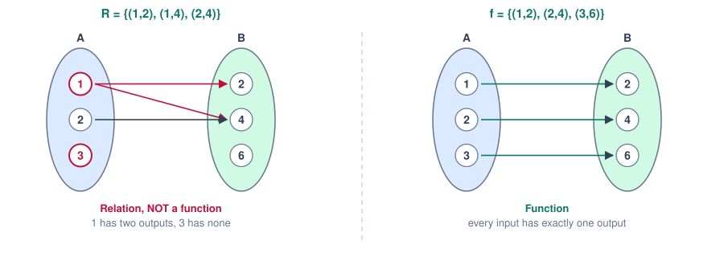
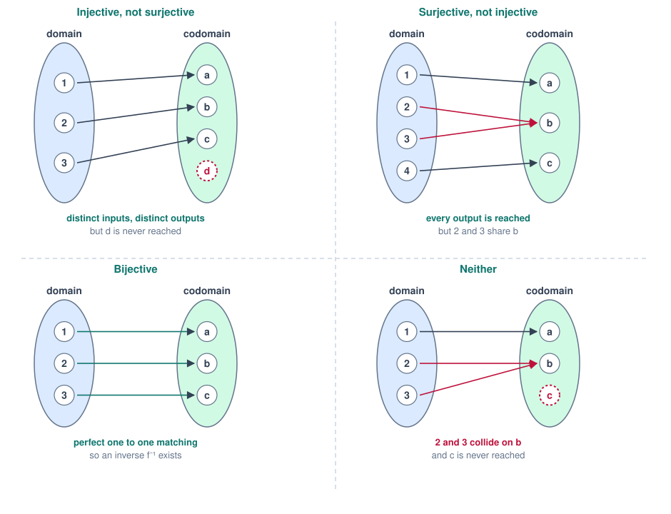
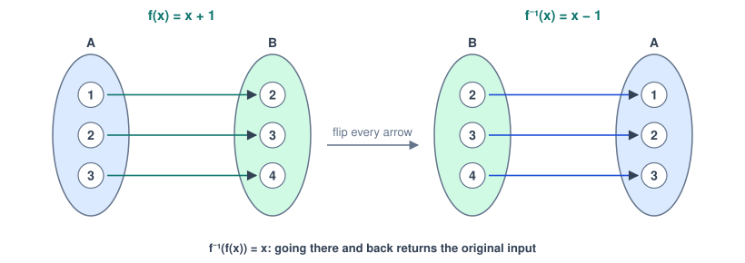

# Functions And Relations

A **function** from a set $X$ to a set $Y$ assigns to **each** element of $X$ **exactly one** element of $Y$. You already know functions from programming: they take an input, compute, and return an output. The big difference is that a mathematical function is **pure**: no side effects, no hidden state, the same input always gives the same output. It is closer to a lookup table than to a method that writes to a database.

---

## Domain, Codomain And Image

Every function has three sets attached to it, and mixing them up causes most of the confusion around injective and surjective functions later on.

| Term | Meaning | Programming analogy |
|---|---|---|
| **Domain** | The set of allowed inputs | The parameter type |
| **Codomain** | The set where outputs are allowed to land | The declared return type |
| **Image** (range) | The outputs that are **actually** produced | The values the function really returns |

The image is always a subset of the codomain. A function declared to return `int` that only ever returns positive numbers has codomain "all ints" but image "positive ints".

### A First Example

Consider

$$f : \mathbb{R}_{\geq 0} \to \mathbb{R}, \qquad f(x) = \sqrt{x}$$

The notation $f : A \to B$ reads "$f$ goes from $A$ to $B$": $A$ is the domain and $B$ is the codomain. The **rule** $f(x) = \sqrt{x}$ says how to compute the output. To **evaluate** the function, you substitute a value from the domain:

| $x$ | $f(x)$ |
|---|---|
| $0$ | $0$ |
| $4$ | $2$ |
| $25$ | $5$ |



Here the domain is $\mathbb{R}_{\geq 0}$, the codomain is $\mathbb{R}$ and the image is $\mathbb{R}_{\geq 0}$, because a square root is never negative. The input $-1$ is not allowed: $\sqrt{-1}$ is not a real number. It does exist in $\mathbb{C}$, so if you changed the codomain to $\mathbb{C}$ you could extend the domain to all of $\mathbb{R}$.

### Choosing The Domain

The same rule can be paired with different domains and codomains, as long as it makes sense. Restricting the domain of $\sqrt{x}$ to $\mathbb{N}$ is perfectly valid, it just produces fewer outputs. When no domain is stated, the convention is to take the **biggest natural domain**: every input for which the rule produces a valid output. For $\frac{1}{x}$ that is $\mathbb{R} \setminus \{0\}$, for $\sqrt{x}$ it is $\mathbb{R}_{\geq 0}$.

### Functions As Machines And Arrows

Two mental pictures are useful. The first is a **machine**: input goes in, output comes out, nothing else happens.

$$\text{input} \longrightarrow f \longrightarrow \text{output}$$

The second is a set of **arrows** from inputs to outputs, which is the picture used for the rest of this note. For $\sqrt{x}$ on perfect squares: $0 \to 0$, $1 \to 1$, $4 \to 2$, $9 \to 3$. The defining rule is that **one input may never have two arrows leaving it**.

---

## Relations

**Relations** describe connections between elements of sets, and they are more general than functions. They are fundamental in computer science: a database table is literally a relation, and the relational model behind SQL is built on this definition.

### Definition

Let $A$ and $B$ be sets. A **relation** $R$ from $A$ to $B$ is any set of **ordered pairs** $(a, b)$ with $a \in A$ and $b \in B$. You write $aRb$ to say that $a$ is related to $b$.

With $A = \{1, 2, 3\}$ and $B = \{2, 4, 6\}$, both of these are valid relations:

$$R_1 = \{(1,2), (2,4), (3,6)\} \qquad\qquad R_2 = \{(1,2), (1,4), (2,4)\}$$

$R_1$ links every number to its double. $R_2$ relates $1$ to both $2$ and $4$, and leaves $3$ unrelated. A relation allows all of that.

### Functions Are Special Relations

A function is a relation with two extra conditions:

1. **Every** element of the domain has an output (no input left out).
2. Every input has **exactly one** output (no input with two arrows).

So $R_1$ is a function, while $R_2$ is not: $1$ has two outputs and $3$ has none.



In SQL terms, a function is like a table where the input column is a **primary key**: each key appears exactly once, so a lookup always returns one row. A general relation is like a many-to-many join table.

---

## Injective, Surjective And Bijective

Once you know something is a function, you can ask two independent questions about it. Do different inputs always give different outputs? Is every element of the codomain reached? The answers give the three named types.



### Injective (One To One)

A function is **injective** when different inputs always produce different outputs. Formally, $f : A \to B$ is injective if

$$f(a) = f(b) \Rightarrow a = b$$

Read it as: "if two outputs are equal, the inputs were already equal". In the arrow picture, **no two arrows land on the same element**. Some codomain elements may be left unused.

- $f(x) = 2x$ is injective: $1 \mapsto 2$, $2 \mapsto 4$, $3 \mapsto 6$, never a collision.
- $f(x) = x^2$ on $\mathbb{R}$ is **not** injective: $f(2) = f(-2) = 4$.

A hash function is the standard CS example of a non-injective function: infinitely many inputs map to a finite set of hashes, so collisions are unavoidable.

### Surjective (Onto)

A function is **surjective** when it reaches **every** element of the codomain, so the image is equal to the **codomain**. Formally, for every $y \in B$ there exists some $x \in A$ with $f(x) = y$. In the arrow picture, **every codomain element receives at least one arrow**.

- $f(x) = x^3$ from $\mathbb{R}$ to $\mathbb{R}$ is surjective: every real $y$ has the cube root $x = \sqrt[3]{y}$ as a preimage.
- $f(x) = x^2$ from $\mathbb{R}$ to $\mathbb{R}$ is **not** surjective: $-1$ is never produced.

Surjectivity depends on the codomain you declare. $x^2$ becomes surjective if you define it as $f : \mathbb{R} \to \mathbb{R}_{\geq 0}$, without touching the rule.

### Bijective (Perfect Matching)

A function is **bijective** when it is **both** injective and surjective. Every element of the codomain is hit by **exactly one** arrow, so domain and codomain are paired up perfectly.

$f(x) = x + 1$ on $\mathbb{R}$ is bijective. It is injective because different $x$ give different $x + 1$, and it is surjective because any $y$ is reached from $x = y - 1$.

### Inverse Functions

Only bijective functions have an **inverse**. If $f : A \to B$ is bijective, there is a function $f^{-1} : B \to A$ that reverses it:

$$f^{-1}(f(x)) = x$$

For $f(x) = x + 1$ the inverse is $f^{-1}(x) = x - 1$, since $f^{-1}(x + 1) = x$.



Why both conditions? Flip every arrow. If the function was not injective, some output now has two arrows leaving it, so the flipped version is not a function. If it was not surjective, some element of $B$ now has no arrow at all, so the flipped version is not defined on all of $B$. Only a perfect matching survives the flip. This is why encryption must be bijective (you need to decrypt), while hashing deliberately is not.

### Summary Table

| Concept | Definition |
|---|---|
| **Relation** | Any collection of ordered pairs |
| **Function** | A relation where every input has exactly one output |
| **Injective** | Different inputs give different outputs |
| **Surjective** | Every element of the codomain is reached |
| **Bijective** | Both injective and surjective |
| **Inverse function** | Exists only for bijective functions |

| Type | Distinct outputs for distinct inputs? | All outputs reached? |
|---|---|---|
| Injective | Yes | Not necessarily |
| Surjective | Not necessarily | Yes |
| Bijective | Yes | Yes |

---

## Testing Properties In Code

For finite functions stored as a dictionary, the definitions translate directly into set operations. This is a good way to check your understanding: each property is one line.

```python
def is_injective(f: dict) -> bool:
    return len(set(f.values())) == len(f)        # no two keys share a value

def is_surjective(f: dict, codomain: set) -> bool:
    return set(f.values()) == codomain           # image equals codomain

def is_bijective(f: dict, codomain: set) -> bool:
    return is_injective(f) and is_surjective(f, codomain)

f = {1: "a", 2: "b", 3: "b", 4: "c"}
print(is_injective(f), is_surjective(f, {"a", "b", "c"}))   # False True
```

---

## Worked Exercises

These use the arrow diagrams from the book. The question to ask for each diagram is always the same: count arrows **leaving** inputs (function?), then arrows **arriving** at outputs (injective? surjective?).

### Is It A Function

$1 \to 2$, $2 \to 4$, $3 \to 6$ with domain $\{1, 2, 3\}$ and codomain $\{2, 4, 6\}$: yes, each input has exactly one output.

$1 \to a$, $1 \to b$, $2 \to c$: no, input $1$ has two outputs.

### Classify The Mapping

$1 \to a$, $2 \to b$, $3 \to b$ with codomain $\{a, b\}$: not injective (2 and 3 both map to $b$).

$1 \to a$, $2 \to b$, $3 \to b$, $4 \to c$ with codomain $\{a, b, c\}$: surjective but not injective. Every output is reached, but $b$ is reached twice.

$1 \to a$, $2 \to b$ with codomain $\{a, b, c\}$: not surjective, because $c$ is never reached.

### Build Your Own

An injective but not surjective function: $f : \{1, 2\} \to \{a, b, c\}$ with $1 \to a$, $2 \to b$. A surjective but not injective one: $\{1, 2, 3\} \to \{a, b\}$ with $1 \to a$, $2 \to b$, $3 \to b$. A bijective one: $1 \to a$, $2 \to b$, $3 \to c$. A relation that is not a function: $\{(1, a), (1, b)\}$.

---

## Quick Recap

- A **function** assigns exactly one output to each input, with no side effects.
- **Domain** = allowed inputs, **codomain** = where outputs may land, **image** = outputs actually hit. Image $\subseteq$ codomain.
- Without a stated domain, take the **biggest natural domain**.
- A **relation** is any set of ordered pairs. A function is a relation where every input appears exactly once.
- **Injective**: no two arrows land on the same output. Test: $f(a) = f(b) \Rightarrow a = b$.
- **Surjective**: every codomain element gets an arrow, so image = **codomain**. Depends on the declared codomain.
- **Bijective**: both, a perfect matching. Only bijections have an **inverse** $f^{-1}$ with $f^{-1}(f(x)) = x$.
