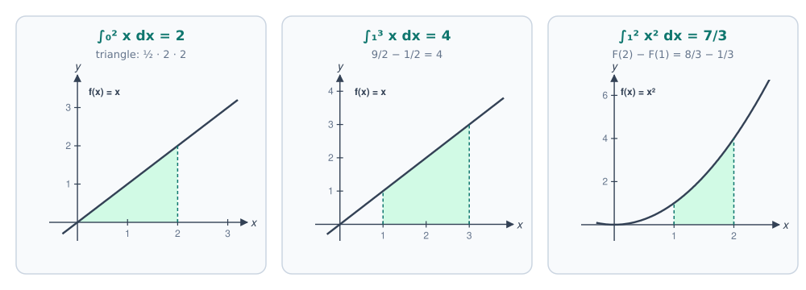
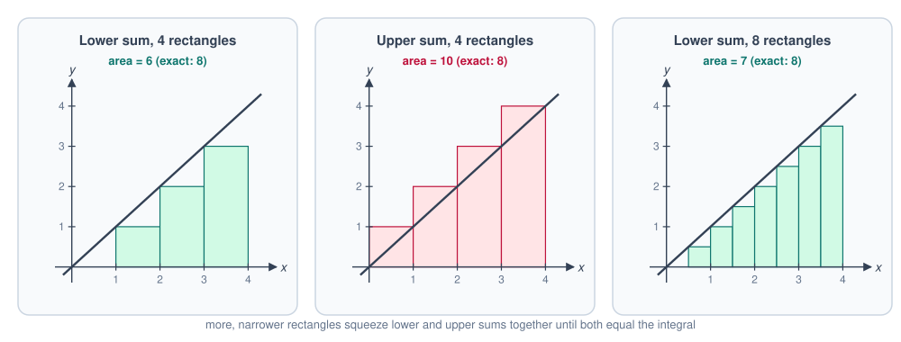
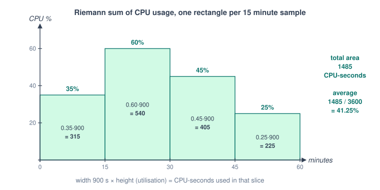
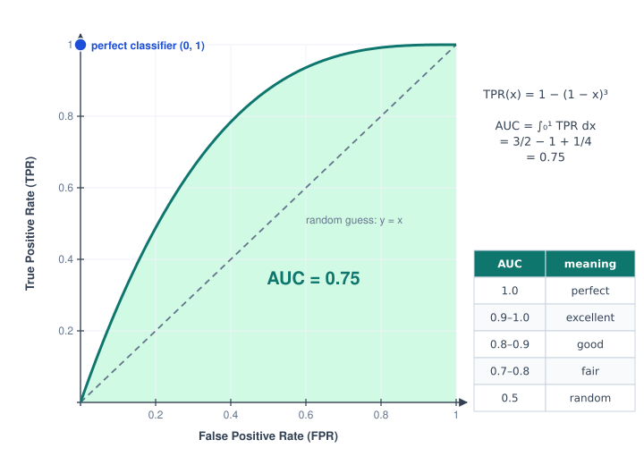

# Integrals

Where derivatives measure **rates of change**, integrals measure **accumulation**: total distance from a speed, total CPU time from a utilization graph, total probability from a density. Differentiation and integration were developed as separate ideas, but one of the most important results in mathematics, the **Fundamental Theorem of Calculus**, shows that they are inverse operations. Read "Derivatives & Gradient Descent" first, because everything here leans on the derivative rules.

---

## Antiderivatives

An **antiderivative** reverses differentiation: $F(x)$ is an antiderivative of $f(x)$ when $F'(x) = f(x)$. Since $\frac{d}{dx}(x^2) = 2x$, an antiderivative of $2x$ is $x^2$. This is written with the **integral sign** $\int$:

$$\int 2x\,dx = x^2 + C$$

The $dx$ says which variable you integrate with respect to. This form, without limits, is called an **indefinite integral**.

### The Constant Of Integration

Why the $+ C$? The derivatives of $x^2$, $x^2 + 5$ and $x^2 - 100$ are all $2x$, because constants disappear when you differentiate. Going backwards, you cannot know which constant was there, so you add an unknown **constant of integration** $C$ to represent all of them at once. Forgetting $C$ is technically wrong for indefinite integrals.

### The Power Rule For Integration

Reverse the power rule for derivatives: instead of "multiply by the exponent, then subtract one", do "add one to the exponent, then divide by the new exponent".

$$\int x^n\,dx = \frac{x^{n+1}}{n+1} + C, \qquad n \neq -1$$

The exception $n = -1$ exists because it would mean dividing by zero ($\int x^{-1}\,dx$ is $\ln|x| + C$, outside this course). You can always check an antiderivative by differentiating it back.

| Integral | Result | Check by differentiating |
|---|---|---|
| $\int x\,dx$ | $\frac{x^2}{2} + C$ | $\frac{2x}{2} = x$ |
| $\int x^2\,dx$ | $\frac{x^3}{3} + C$ | $\frac{3x^2}{3} = x^2$ |
| $\int x^3\,dx$ | $\frac{x^4}{4} + C$ | $x^3$ |
| $\int 4x^3\,dx$ | $x^4 + C$ | $4x^3$ |
| $\int 5x^4\,dx$ | $x^5 + C$ | $5x^4$ |
| $\int (3x^2 + 1)\,dx$ | $x^3 + x + C$ | $3x^2 + 1$ |
| $\int e^x\,dx$ | $e^x + C$ | $e^x$ |

---

## Definite Integrals

A **definite integral** has **limits**: it computes the accumulated quantity between $x = a$ and $x = b$, which is the **area under the graph** of $f$ between those two points (counting area below the x-axis as negative).

$$\int_a^b f(x)\,dx$$

Here $a$ is the **lower limit** and $b$ the **upper limit**. A definite integral gives a **number**, not a function, so there is no $+ C$.

### Evaluating With Brackets

To evaluate, find an antiderivative $F$, then compute $F(b) - F(a)$. The bracket notation $\big[F(x)\big]_a^b$ is shorthand for exactly that subtraction.

$$\int_0^2 x\,dx = \left[\frac{x^2}{2}\right]_0^2 = \frac{2^2}{2} - \frac{0^2}{2} = 2$$

That matches geometry: the region under $f(x) = x$ from $0$ to $2$ is a triangle with base $2$ and height $2$, area $\frac{1}{2} \cdot 2 \cdot 2 = 2$.



With limits $1$ and $3$: $\int_1^3 x\,dx = \frac{9}{2} - \frac{1}{2} = 4$. A quick sanity check for this one: the region is a trapezoid, and if you level the slanted top around its midpoint $(2, 2)$ you get a rectangle of width $2$ and height $2$, area $4$.

---

## The Fundamental Theorem Of Calculus

The **Fundamental Theorem of Calculus** (FTC) states that differentiation and integration are inverse operations. Concretely:

$$\text{If } F'(x) = f(x), \text{ then } \int_a^b f(x)\,dx = F(b) - F(a)$$

This is what makes the bracket method work. Without it, computing an area under a curved graph would require adding up infinitely many slices. With it, the hard problem "find an area" turns into the much easier problem "find an antiderivative".

### Why It Makes Sense

Think of $F(x)$ as the total area accumulated from some starting point up to $x$. If you move $x$ a tiny bit further, the area grows by a thin strip of height $f(x)$. So the rate at which the area grows is $f(x)$, meaning $F'(x) = f(x)$. The area function is an antiderivative, and the area between $a$ and $b$ is "total up to $b$ minus total up to $a$". It is the same logic as an odometer: the distance driven between two moments is the reading at the end minus the reading at the start.

### Examples

$$\int_1^3 2x\,dx = \big[x^2\big]_1^3 = 9 - 1 = 8$$

$$\int_1^2 x^2\,dx = \left[\frac{x^3}{3}\right]_1^2 = \frac{8}{3} - \frac{1}{3} = \frac{7}{3}$$

Verifying the FTC for $f(x) = 3x^2$ on $[0, 2]$: $F(x) = x^3$ satisfies $F'(x) = 3x^2$, and $\int_0^2 3x^2\,dx = F(2) - F(0) = 8$. Going the other way, $\int x^4\,dx = \frac{x^5}{5} + C$ and $\frac{d}{dx}\left(\frac{x^5}{5} + C\right) = x^4$: you get back exactly where you started.

---

## Riemann Sums

Underneath every integral is a **Riemann sum**: an approximation of the area by a finite number of rectangles. Computers calculate integrals numerically this way all the time, especially when no antiderivative formula exists.

### Lower And Upper Sums

Split the interval into equal strips and draw a rectangle on each strip. For an increasing function like $f(x) = x$ on $[0, 4]$:

- The **lower sum** uses the function value at the **left** end of each strip, so every rectangle sits under the curve and the total **underestimates** the area.
- The **upper sum** uses the value at the **right** end, so every rectangle pokes above the curve and the total **overestimates** the area.



| Approximation | Area |
|---|---|
| Lower sum, 4 rectangles | $1 \cdot (0 + 1 + 2 + 3) = 6$ |
| Upper sum, 4 rectangles | $1 \cdot (1 + 2 + 3 + 4) = 10$ |
| Lower sum, 8 rectangles | $0.5 \cdot (0 + 0.5 + \dots + 3.5) = 7$ |
| Upper sum, 8 rectangles | $0.5 \cdot (0.5 + 1 + \dots + 4) = 9$ |
| Exact integral $\int_0^4 x\,dx$ | $\left[\frac{x^2}{2}\right]_0^4 = 8$ |

As the rectangles get narrower, the lower and upper sums squeeze together. In the **limit** where the width goes to zero, both converge to the exact integral. That limit **is** the definition of the (Riemann) integral.

### Riemann Sums In Code

A Riemann sum is a loop, which makes it the natural way for a program to integrate. More rectangles means a better answer.

```python
def riemann(f, a, b, n, side="left"):
    width = (b - a) / n
    offset = 0 if side == "left" else width
    return sum(f(a + i * width + offset) * width for i in range(n))

f = lambda x: x
for n in (4, 8, 100, 10_000):
    print(n, riemann(f, 0, 4, n, "left"), riemann(f, 0, 4, n, "right"))
# both columns approach the exact value 8
```

---

## Applications In Computer Science

Integrals are less visible than derivatives in day to day programming, but they sit underneath many standard tools.

### Accumulated Resource Usage

If a server uses CPU at rate $C(t)$, the total CPU consumed between times $a$ and $b$ is $\int_a^b C(t)\,dt$. In practice you only have samples, so you use a Riemann sum: each sample times the length of the interval it represents.



Samples of $35\%$, $60\%$, $45\%$ and $25\%$ every 15 minutes ($900$ s) give

$$0.35 \cdot 900 + 0.60 \cdot 900 + 0.45 \cdot 900 + 0.25 \cdot 900 = 315 + 540 + 405 + 225 = 1485 \text{ CPU-seconds}$$

and the average utilisation over the hour is $\frac{1485}{3600} = 41.25\%$. This is the "area divided by width" definition of an **average value**. Cloud providers bill exactly this way: at €0.04 per CPU-hour, samples of $20\%$, $50\%$, $80\%$, $40\%$ give $1710$ CPU-seconds $= 0.475$ CPU-hours, costing $0.475 \cdot 0.04 = €0.019$.

A related trap: a high Linux **load average** does not mean high CPU usage. Load average counts processes that are running **or waiting**, so processes blocked on disk I/O, network calls, file locks or database access raise the load while the CPU sits mostly idle.

### Probability And Expected Value

For a continuous random variable with **probability density function** $f(x)$, probabilities are areas under the density:

$$P(a \leq X \leq b) = \int_a^b f(x)\,dx \qquad\qquad E[X] = \int_{-\infty}^{\infty} x\,f(x)\,dx$$

The **expected value** $E[X]$ is the long-run average. Signal processing uses integrals the same way to compute the total energy and the average value of a signal, and many machine learning models are defined in terms of expectations even though they are trained with derivatives.

---

## AUC In Machine Learning

A classifier (spam or not spam, sick or healthy, click or no click) usually outputs a **score** between $0$ and $1$, and you choose a **threshold** above which you predict "positive". Every threshold gives a different trade-off, and the **ROC curve** (Receiver Operating Characteristic) shows all of them at once.

### The ROC Curve

The ROC curve plots, for every threshold:

- the **True Positive Rate** (TPR, the share of real positives you catch) on the vertical axis,
- the **False Positive Rate** (FPR, the share of real negatives you wrongly flag) on the horizontal axis.

A perfect classifier reaches the corner $(0, 1)$: all positives caught, no false alarms. A classifier that guesses randomly follows the diagonal $y = x$.

### Area Under The Curve

The **AUC** is the area under the ROC curve, a single number that summarises the whole curve:

$$\text{AUC} = \int_0^1 \text{TPR}(\text{FPR})\;d(\text{FPR}), \qquad 0 \leq \text{AUC} \leq 1$$



| AUC | Interpretation |
|---|---|
| $1.0$ | Perfect classifier |
| $0.9$ to $1.0$ | Excellent |
| $0.8$ to $0.9$ | Good |
| $0.7$ to $0.8$ | Fair |
| $0.5$ | Random guessing |

### Computing An AUC

For the ROC curve $\text{TPR}(x) = 1 - (1 - x)^3$, expand the integrand first:

$$1 - (1 - 3x + 3x^2 - x^3) = 3x - 3x^2 + x^3$$

$$\text{AUC} = \int_0^1 (3x - 3x^2 + x^3)\,dx = \left[\frac{3}{2}x^2 - x^3 + \frac{x^4}{4}\right]_0^1 = \frac{3}{2} - 1 + \frac{1}{4} = 0.75$$

So this classifier is "fair". Keep in mind that the ROC curve compares classifiers across all thresholds, but it does **not** tell you which threshold to use. That depends on the application: a cancer screening test and a spam filter weigh false negatives and false positives very differently.

---

## Worked Exercises

These mirror the integral exercises of the course book.

### Definite Integrals

$\int_0^1 x\,dx = \left[\frac{x^2}{2}\right]_0^1 = \frac{1}{2}$. $\int_0^2 2x\,dx = \big[x^2\big]_0^2 = 4$. $\int_1^3 x^2\,dx = \left[\frac{x^3}{3}\right]_1^3 = 9 - \frac{1}{3} = \frac{26}{3}$.

### Requests Processed

A server handles $R(t) = 100t$ requests per hour ($t$ in hours). In the first two hours it handles $\int_0^2 100t\,dt = 100\left[\frac{t^2}{2}\right]_0^2 = 200$ requests.

### AUC Of Simple Curves

$\text{TPR}(x) = x^2$ (with $x$ the FPR): $\int_0^1 x^2\,dx = \frac{1}{3}$. That is **below** $0.5$, so this classifier does worse than random guessing; flipping its predictions would give AUC $\frac{2}{3}$.

$\text{TPR}(x) = 2x - x^2$: $\int_0^1 (2x - x^2)\,dx = \left[x^2 - \frac{x^3}{3}\right]_0^1 = 1 - \frac{1}{3} = \frac{2}{3}$.

---

## Quick Recap

- An **antiderivative** $F$ satisfies $F' = f$. Indefinite integrals need $+ C$ because constants vanish when differentiating.
- **Power rule**: $\int x^n\,dx = \frac{x^{n+1}}{n+1} + C$ for $n \neq -1$. Check by differentiating back.
- A **definite integral** $\int_a^b f(x)\,dx$ is the (signed) **area under the curve**, a number with no $C$.
- **FTC**: $\int_a^b f(x)\,dx = F(b) - F(a)$. Integration and differentiation are inverses.
- **Riemann sums** approximate the area with rectangles; lower sums underestimate, upper sums overestimate, and both converge to the integral as the width goes to $0$.
- CS uses: total resource usage from samples, **average = area / width**, probabilities and expected values for continuous variables.
- **AUC** = area under the ROC curve (TPR vs FPR). $1$ is perfect, $0.5$ is random.
