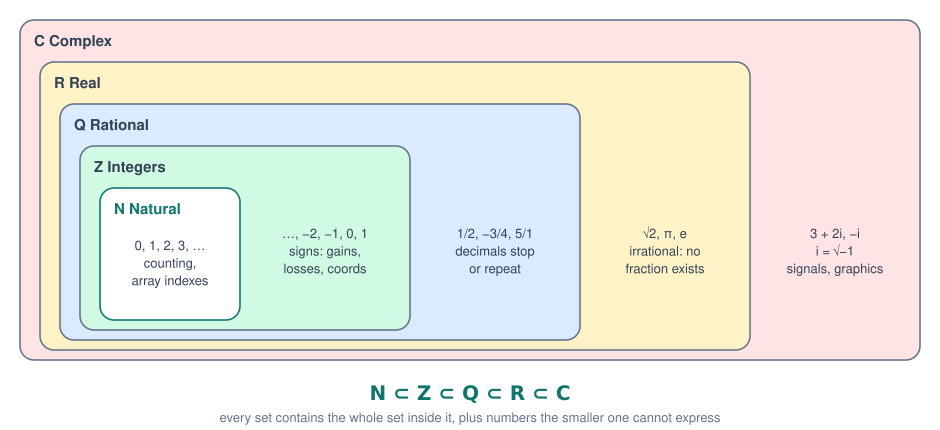
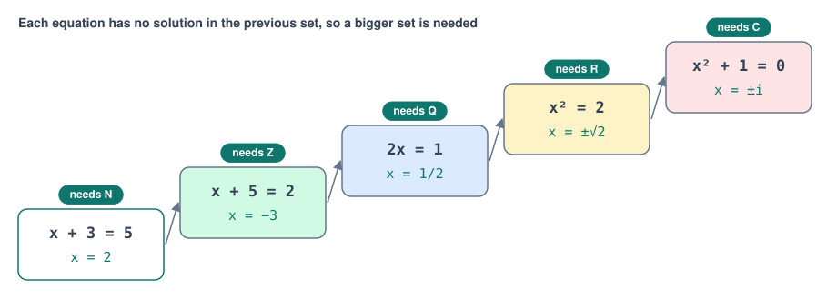
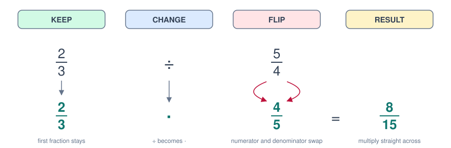
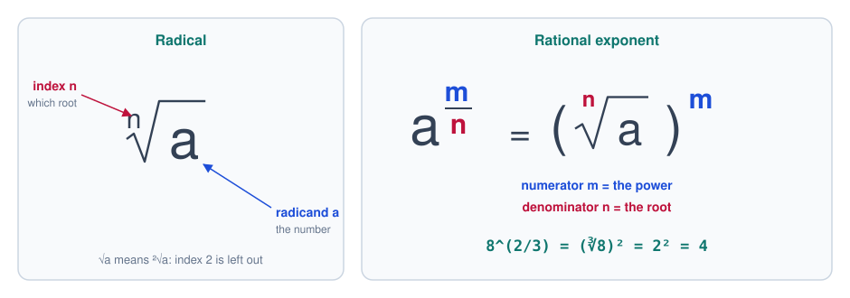

# Numbers And Arithmetic

Algebra is a generalization of arithmetic: instead of only working with fixed numbers, it introduces **variables** and rules for manipulating expressions that contain them. Before you can manipulate expressions, you need to be fluent with the objects inside them, which are numbers and the operations on numbers. This note covers the number systems, fractions, powers, roots, rational exponents and radicals. Solving equations builds on all of this and lives in "Equations".

---

## Anatomy Of An Algebraic Expression

An algebraic expression mixes numbers, letters and operations. Each letter has a specific role, and knowing the role tells you what you are allowed to change while solving a problem.

$$7x^3 + ax + c$$

| Part | In the example | Role |
|---|---|---|
| **Coefficient** | $7$ and $a$ | Number multiplying a variable term |
| **Variable** | $x$ | Can take any value, this is what we usually solve for |
| **Exponent (power)** | $3$ | How many times $x$ is multiplied by itself |
| **Parameter** | $a$ | Treated as fixed for one particular problem, but can change between problems |
| **Constant** | $c$ | Never changes |

The difference between a parameter and a variable is a matter of perspective. Think of a function in code with a default argument: inside one call, the argument is fixed (parameter), but the function body is written for any input (variable). Once you know $a$ and $c$, the expression gives a result for every value of $x$.

---

## Number Systems

Numbers need a representation for the human mind, and we generally use the **decimal system** (base 10). As a computer scientist you also know binary (base 2), octal (base 8) and hexadecimal (base 16). The representation changes, the number itself does not: `0b1010`, `0xA` and `10` are the same value.

Mathematics uses several **classes** of numbers. Each class extends the previous one so that more problems can be solved.



### The Five Sets

| Set | Symbol | Contains | Examples | Typical use |
|---|---|---|---|---|
| **Natural numbers** | $\mathbb{N}$ | Counting numbers | $0, 1, 2, 3, \dots$ | Counting, indexing arrays and lists |
| **Integers** | $\mathbb{Z}$ | Naturals plus negatives | $\dots, -2, -1, 0, 1, 2, \dots$ | Gains and losses, signed coordinates |
| **Rational numbers** | $\mathbb{Q}$ | Fractions $\frac{p}{q}$ with $p, q \in \mathbb{Z}$, $q \neq 0$ | $\frac{1}{2}, -\frac{3}{4}, 5 = \frac{5}{1}$ | Ratios, exact decimal values |
| **Real numbers** | $\mathbb{R}$ | Rationals plus irrationals | $\sqrt{2}, \pi, e$ | Every point on the number line, calculus, ML |
| **Complex numbers** | $\mathbb{C}$ | $a + bi$ with $a, b \in \mathbb{R}$ and $i = \sqrt{-1}$ | $3 + 2i, -i, 5$ | Signal processing, graphics, control theory |

The sets form a strict hierarchy:

$$\mathbb{N} \subset \mathbb{Z} \subset \mathbb{Q} \subset \mathbb{R} \subset \mathbb{C}$$

Every set contains all the elements of the previous one, so $5$ is a natural number, but also an integer, a rational ($\frac{5}{1}$), a real and a complex number ($5 + 0i$). When you **classify** a number, you name the **smallest** set it belongs to.

### How To Recognise Each Kind

A **rational** number always has a decimal expansion that either **terminates** ($0.25$, $1.75$) or **repeats** ($0.333\dots$). An **irrational** number has a decimal expansion that never stops and never repeats, which is exactly why it cannot be written as a fraction of two integers. Some irrationals, such as $\pi$ and $e$, are so special that they are called **transcendental**: they are not the root of any polynomial equation with integer coefficients.

### Why Bigger Sets Exist

The need for a larger number system usually comes from an equation that has no solution in the current one. Each step up the ladder below is forced by an equation.



The pattern is that every inverse operation eventually breaks out of its set: subtraction breaks $\mathbb{N}$, division breaks $\mathbb{Z}$, square roots break $\mathbb{Q}$, and square roots of negatives break $\mathbb{R}$.

### Proving √2 Is Irrational

This classic proof shows the technique of **proof by contradiction**: assume the opposite of what you want, and show that it leads to something impossible.

1. Assume $\sqrt{2}$ is rational, so $\sqrt{2} = \frac{a}{b}$ with $a, b \in \mathbb{Z}$, $b \neq 0$, and the fraction in lowest terms, meaning $\gcd(a, b) = 1$.
2. Square both sides: $2 = \frac{a^2}{b^2}$, so $a^2 = 2b^2$. That means $a^2$ is even.
3. The square of an odd number is odd, so $a$ itself must be even. Write $a = 2k$.
4. Substitute: $(2k)^2 = 2b^2 \Rightarrow 4k^2 = 2b^2 \Rightarrow b^2 = 2k^2$. So $b^2$ is even, and therefore $b$ is even.
5. Now both $a$ and $b$ are even, so $2$ divides both. That contradicts $\gcd(a, b) = 1$.

The assumption was false, so $\sqrt{2}$ is irrational. The same proof works for $\sqrt{p}$ with any prime $p$: replace "even" with "divisible by $p$" and use the fact that if a prime divides $a^2$, it divides $a$.

---

## Fractions

A **fraction** $\frac{a}{b}$ represents a part of a whole, or more generally the division of $a$ by $b$. The top number $a$ is the **numerator**, the bottom number $b$ is the **denominator**, and the denominator must never be $0$.

### Simplifying

A fraction is **simplified** (in lowest terms) when the numerator and denominator have no common divisor other than $1$. Divide both by their greatest common divisor:

$$\frac{6}{8} = \frac{6 \div 2}{8 \div 2} = \frac{3}{4}$$

This works because dividing top and bottom by the same number is the same as dividing the fraction by $\frac{2}{2} = 1$, which does not change its value.

### Adding And Subtracting

You can only add fractions that describe pieces of the **same size**, so the denominators must match first. If they differ, rewrite both fractions over a **common denominator**:

$$\frac{1}{3} + \frac{2}{3} = \frac{3}{3} = 1 \qquad\qquad \frac{1}{2} + \frac{1}{3} = \frac{3}{6} + \frac{2}{6} = \frac{5}{6}$$

Subtraction works exactly the same way.

### Multiplying

Multiplying is simpler, because no common denominator is needed. Multiply the numerators together and the denominators together, then simplify:

$$\frac{a}{b} \cdot \frac{c}{d} = \frac{ac}{bd} \qquad\qquad \frac{2}{3} \cdot \frac{5}{4} = \frac{10}{12} = \frac{5}{6}$$

### Dividing: Keep, Change, Flip

To divide by a fraction, multiply by its **reciprocal**. The reciprocal of $\frac{c}{d}$ is $\frac{d}{c}$.

$$\frac{a}{b} \div \frac{c}{d} = \frac{a}{b} \cdot \frac{d}{c}$$

The memory rule is **keep, change, flip**: keep the first fraction, change $\div$ into $\cdot$, flip the second fraction.



Why does flipping work? Dividing by a number asks "how many of these fit in?". Asking how many quarters fit into one half is the same as multiplying by $4$, because each whole holds four quarters: $\frac{1}{2} \div \frac{1}{4} = \frac{1}{2} \cdot 4 = 2$.

### Common Mistakes With Fractions

| Mistake | Wrong | Right |
|---|---|---|
| Dividing top and bottom separately | $\frac{1}{2} \div \frac{1}{4} = \frac{1 \div 1}{2 \div 4}$ | $\frac{1}{2} \cdot \frac{4}{1} = 2$ |
| Flipping the first fraction | $\frac{2}{3} \div \frac{5}{4} = \frac{3}{2} \cdot \frac{5}{4}$ | $\frac{2}{3} \cdot \frac{4}{5} = \frac{8}{15}$ |
| Forgetting to simplify | $\frac{3}{4} \div \frac{1}{2} = \frac{6}{4}$ | $\frac{6}{4} = \frac{3}{2}$ |
| Dividing by zero | $\frac{1}{2} \div 0 = ?$ | **Undefined**: $0$ has no reciprocal |

A useful sanity check: dividing a positive number by a fraction smaller than $1$ always makes it **bigger**. If your answer shrank, something went wrong.

---

## Powers

**Powers** are shorthand for repeated multiplication. Instead of writing $2 \cdot 2 \cdot 2 \cdot 2$, you write $2^4$.

$$a^n = \underbrace{a \cdot a \cdot \ldots \cdot a}_{n \text{ factors}}$$

Here $a$ is the **base** and $n$ is the **exponent** (or power). $a^2$ is called the **square** of $a$ and $a^3$ the **cube**.

### Zero And Negative Exponents

Two definitions extend powers beyond positive whole exponents, and both follow from the division rule below. Since $\frac{a^n}{a^n} = 1$ and also $\frac{a^n}{a^n} = a^{n-n} = a^0$, it must be that:

$$a^0 = 1 \quad (a \neq 0)$$

And since $a^{-n} = a^{0-n} = \frac{a^0}{a^n}$, a negative exponent means a **reciprocal**:

$$a^{-n} = \frac{1}{a^n} \qquad\qquad 2^{-3} = \frac{1}{2^3} = \frac{1}{8}$$

### The Three Rules

All three rules come straight from counting factors. $a^m \cdot a^n$ is $m$ factors followed by $n$ more factors, so $m + n$ factors in total.

| Rule | Formula | Example |
|---|---|---|
| **Product** (same base) | $a^m \cdot a^n = a^{m+n}$ | $2^3 \cdot 2^4 = 2^7 = 128$ |
| **Quotient** (same base) | $\frac{a^m}{a^n} = a^{m-n}$, $a \neq 0$ | $\frac{3^5}{3^2} = 3^3 = 27$ |
| **Power of a power** | $(a^m)^n = a^{mn}$ | $(2^3)^2 = 2^6 = 64$ |

In computer science you meet powers constantly: a byte holds $2^8 = 256$ values, an IPv4 address space has $2^{32}$ addresses, and $1\text{ KiB} = 2^{10}$ bytes.

### Common Mistakes With Powers

The order of operations matters a lot with powers, because the exponent binds tighter than a minus sign.

| Mistake | Wrong | Right |
|---|---|---|
| Power is not multiplication | $3^2 = 3 \cdot 2 = 6$ | $3^2 = 3 \cdot 3 = 9$ |
| Adding powers is not adding exponents | $2^3 + 2^3 = 2^6$ | $2^3 + 2^3 = 8 + 8 = 16$ |
| Minus sign outside the power | $-2^2 = 4$ | $-2^2 = -(2^2) = -4$, but $(-2)^2 = 4$ |
| Anything to the power zero | $5^0 = 0$ | $5^0 = 1$ |

The same trap exists in code. In Python, `-2**2` evaluates to `-4` because `**` binds tighter than unary minus.

```python
print(-2**2)    # -4
print((-2)**2)  # 4
print(2**3 + 2**3 == 2**6)  # False: 16 vs 64
```

---

## Roots

**Roots** are the inverse operation of powers. Just as division undoes multiplication, taking a root undoes raising to a power.

### Square Roots

The **square root** $\sqrt{a}$ is the non-negative number whose square equals $a$. So $\sqrt{9} = 3$ because $3^2 = 9$. Squaring and square rooting undo each other:

$$\sqrt{a^2} = a \quad (a \geq 0) \qquad\qquad (\sqrt{a})^2 = a$$

The condition $a \geq 0$ matters. For negative $a$, $\sqrt{(-3)^2} = \sqrt{9} = 3$, not $-3$. The fully general rule is $\sqrt{a^2} = |a|$, the absolute value.

A **perfect square** is an integer that is the square of another integer: $1, 4, 9, 16, 25, 36, 49, \dots$ Their roots are whole numbers. Every other positive integer has an **irrational** square root, such as $\sqrt{2} \approx 1.4142$ and $\sqrt{3} \approx 1.7321$.

### Higher Roots

The **cube root** $\sqrt[3]{a}$ undoes a cube: $\sqrt[3]{8} = 2$ because $2^3 = 8$, and $\sqrt[3]{125} = 5$. In general $\sqrt[n]{a}$ is the number that gives $a$ when raised to the power $n$. Unlike square roots, odd roots of negative numbers are fine in $\mathbb{R}$: $\sqrt[3]{-8} = -2$.

### Common Mistakes With Roots

The square root of a negative number does not exist in $\mathbb{R}$, only in $\mathbb{C}$. The biggest mistake, though, is splitting a root over a sum:

$$\sqrt{9} + \sqrt{16} = 3 + 4 = 7 \qquad\text{but}\qquad \sqrt{9 + 16} = \sqrt{25} = 5$$

$$\sqrt{a + b} \neq \sqrt{a} + \sqrt{b}$$

Roots split over **multiplication** and **division**, never over addition or subtraction. The same is true for powers: $(a + b)^2 \neq a^2 + b^2$.

---

## Rational Exponents

Exponents can also be fractions. A **rational exponent** is just another notation for a root, and the big advantage is that all the power rules keep working.

$$a^{\frac{1}{2}} = \sqrt{a} \qquad\qquad a^{\frac{1}{3}} = \sqrt[3]{a} \qquad\qquad a^{\frac{m}{n}} = \sqrt[n]{a^m} = \left(\sqrt[n]{a}\right)^m$$

Why is $a^{\frac{1}{2}} = \sqrt{a}$? Apply the product rule: $a^{\frac{1}{2}} \cdot a^{\frac{1}{2}} = a^{\frac{1}{2} + \frac{1}{2}} = a^1 = a$. A number that multiplied by itself gives $a$ is exactly the definition of $\sqrt{a}$.



### Reading m/n

The **denominator** is the **root**, the **numerator** is the **power**. A good way to remember it: the denominator is "down at the root".

$$8^{\frac{2}{3}} = \left(\sqrt[3]{8}\right)^2 = 2^2 = 4 \qquad\qquad 16^{\frac{3}{4}} = \left(\sqrt[4]{16}\right)^3 = 2^3 = 8$$

### Common Mistakes With Rational Exponents

Swapping the numerator and denominator is the classic error: $8^{\frac{2}{3}}$ is the cube root squared, not the square root cubed ($\sqrt[2]{8^3}$). The second tip is about order: mathematically both orders give the same result, but **taking the root first** keeps the numbers small. Computing $16^{\frac{3}{4}}$ as $\sqrt[4]{16^3} = \sqrt[4]{4096}$ is much harder by hand than $(\sqrt[4]{16})^3 = 2^3$.

---

## Radicals

The symbol $\sqrt{\phantom{a}}$ is the **radical sign**, and any expression with roots is a **radical**. In $\sqrt[n]{a}$, $n$ is the **index** and $a$ is the **radicand**. For square roots the index $2$ is left out.

### Simplifying Radicals

Look for a **perfect square factor** inside the radicand, split it off and take its root. This uses the rule $\sqrt{ab} = \sqrt{a}\sqrt{b}$.

$$\sqrt{12} = \sqrt{4 \cdot 3} = \sqrt{4}\sqrt{3} = 2\sqrt{3} \qquad\qquad \sqrt{75} = \sqrt{25 \cdot 3} = 5\sqrt{3}$$

Always pick the **largest** perfect square factor. For $\sqrt{72}$, using $4$ gives $2\sqrt{18}$ which is not finished, while using $36$ gives $6\sqrt{2}$ directly.

### Multiplying And Dividing Radicals

Radicals with the same index can be combined under one radical sign:

$$\sqrt{a} \cdot \sqrt{b} = \sqrt{ab} \qquad\qquad \frac{\sqrt{a}}{\sqrt{b}} = \sqrt{\frac{a}{b}} \quad (b > 0)$$

$$\sqrt{2} \cdot \sqrt{8} = \sqrt{16} = 4 \qquad\qquad \frac{\sqrt{50}}{\sqrt{2}} = \sqrt{25} = 5$$

### Adding And Subtracting Radicals

Radicals behave like variables here: you can only add **like terms**, meaning the same radical part. Think of $\sqrt{3}$ as a unit, just like $x$ in $2x + 5x = 7x$.

$$2\sqrt{3} + 5\sqrt{3} = 7\sqrt{3} \qquad\qquad \sqrt{2} + \sqrt{3} \text{ cannot be simplified}$$

Often the radicals only become like terms **after** simplifying them, so always simplify first:

$$\sqrt{12} + \sqrt{27} = 2\sqrt{3} + 3\sqrt{3} = 5\sqrt{3} \qquad\qquad \sqrt{8} + \sqrt{18} = 2\sqrt{2} + 3\sqrt{2} = 5\sqrt{2}$$

---

## Worked Exercises

These are representative exercises from the course book, with the reasoning written out. Try them yourself first, then compare.

### Classify Numbers

Name the smallest set for $7$, $-12$, $\frac{8}{3}$ and $\sqrt{2}$. The answers are $7 \in \mathbb{N}$, $-12 \in \mathbb{Z}$, $\frac{8}{3} \in \mathbb{Q}$ and $\sqrt{2} \in \mathbb{R}$. For $\sqrt{5}$, since $5$ is prime, the generalised proof says it is irrational, so $\sqrt{5} \in \mathbb{R}$.

### Fractions In Context

A recipe needs $\frac{3}{4}$ cup of flour and you make half the recipe. "Half of" means multiply by $\frac{1}{2}$: $\frac{3}{4} \cdot \frac{1}{2} = \frac{3}{8}$ cup.

Spot the error in $\frac{1}{2} \div \frac{1}{4} = \frac{1}{8}$. The fractions were multiplied instead of divided. Keep, change, flip gives $\frac{1}{2} \cdot \frac{4}{1} = 2$.

Converting decimals: $0.75 = \frac{75}{100} = \frac{3}{4}$ and $1.2 = \frac{12}{10} = \frac{6}{5}$.

### Powers And Roots

$(-2)^2 = 4$ is true, $2^3 + 2^3 = 2^6$ is false ($16 \neq 64$), $(2^3)^2 = 2^6$ is true and $5^0 = 0$ is false ($5^0 = 1$).

$32^{\frac{4}{5}} = (\sqrt[5]{32})^4 = 2^4 = 16$ and $27^{\frac{2}{3}} = (\sqrt[3]{27})^2 = 3^2 = 9$.

### Radicals

$3\sqrt{8} - \sqrt{18} = 3 \cdot 2\sqrt{2} - 3\sqrt{2} = 6\sqrt{2} - 3\sqrt{2} = 3\sqrt{2}$.

$\sqrt{7} \cdot \sqrt{28} = \sqrt{196} = 14$, and $\sqrt[5]{x^2} = x^{\frac{2}{5}}$.

---

## Quick Recap

- **Expression parts**: coefficients multiply, variables vary, parameters are fixed per problem, constants never change.
- **Number sets**: $\mathbb{N} \subset \mathbb{Z} \subset \mathbb{Q} \subset \mathbb{R} \subset \mathbb{C}$. Each one exists because some equation has no solution in the smaller set. Classify by the **smallest** set.
- **Rational vs irrational**: rational decimals stop or repeat, irrational decimals do neither. $\sqrt{p}$ is irrational for every prime $p$ (proof by contradiction).
- **Fractions**: common denominator for $+$ and $-$, straight across for $\cdot$, **keep change flip** for $\div$. Never divide by $0$.
- **Powers**: $a^m a^n = a^{m+n}$, $\frac{a^m}{a^n} = a^{m-n}$, $(a^m)^n = a^{mn}$, $a^0 = 1$, $a^{-n} = \frac{1}{a^n}$. Watch $-2^2 = -4$.
- **Roots**: inverse of powers, $\sqrt{a^2} = |a|$. Roots split over $\cdot$ and $\div$, **never** over $+$ or $-$.
- **Rational exponents**: $a^{\frac{m}{n}} = (\sqrt[n]{a})^m$, denominator is the root, numerator the power. Take the root first.
- **Radicals**: pull out the largest perfect square, then add only like radicals.
