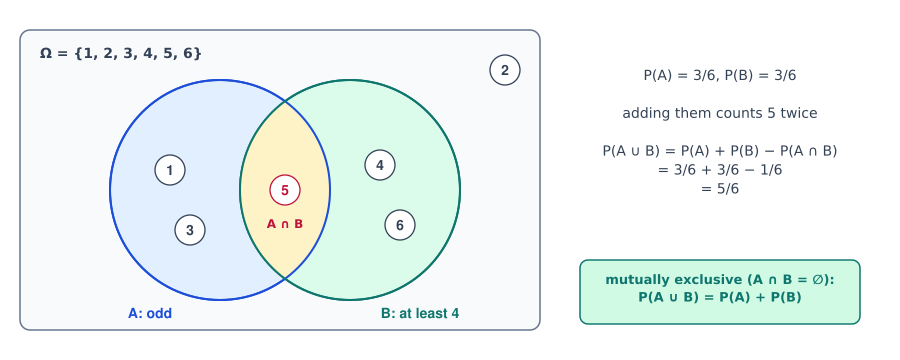
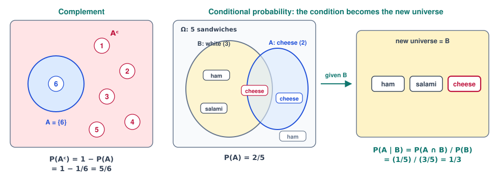
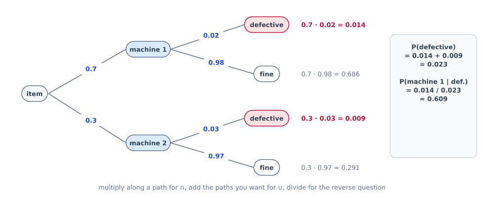

# Probability Foundations

**Probability theory** studies situations that are subject to chance, such as rolling a die, drawing a card, or a network packet getting lost. Every probability problem is solved the same way: first capture the essence of the story in a **probability model**, then apply a small set of rules to that model. This note covers the model and the rules for combining events. Counting techniques for large sample spaces follow in "Combinatorics".

---

## Building A Probability Model

Probability problems usually arrive as a story, and the first job is to strip the story down to a precise **experiment**.

> **The drinking problem.** Frans and Fons cannot agree on who pays for the beer. The café owner rolls a die: on a $1$, Frans pays, otherwise Fons pays. What is the probability that each man pays?

The experiment, described briefly but completely and unambiguously, is: **"roll a fair die and count the pips"**. From there, every probability model has the same three ingredients.

### Sample Space

When you perform an experiment, the outcome is unpredictable, but you can usually list every possible outcome. That set is the **sample space** or **universe**, written $\Omega$ (omega). For the die:

$$\Omega = \{1, 2, 3, 4, 5, 6\}$$

This course restricts itself to **finite** sample spaces.

### Events

An **event** is a **subset** of the sample space: a collection of one or more outcomes you are interested in. Events get capital letters $A$, $B$, $C$.

$$A = \text{"rolling two or more"} = \{2, 3, 4, 5, 6\} \subseteq \Omega$$

An event with only one outcome, like "rolling a 1" $= \{1\}$, is an **elementary event**. Two events deserve special names:

| Event | Set | Example |
|---|---|---|
| **Certain event** | $\Omega$ itself | Rolling a number less than $7$ |
| **Impossible event** | The empty set $\emptyset$ | Rolling a $7$ |

Thinking of events as sets is the key move of the whole subject: "A or B", "A and B" and "not A" become union, intersection and complement, and all of set theory becomes available.

### Probabilities

The last ingredient assigns a number $P(A)$ to every event $A$: the **probability** that $A$ occurs. There are two standard ways to get these numbers.

---

## Assigning Probabilities

The method depends on whether you can argue that all outcomes are equally likely.

### Laplace's Rule

If $\Omega$ is **finite** and all outcomes are **equally likely**, then every outcome has probability $\frac{1}{\#\Omega}$, and for any event

$$P(A) = \frac{\text{number of favourable outcomes}}{\text{number of possible outcomes}} = \frac{\#A}{\#\Omega}$$

where $\#A$ means the number of elements in $A$. For the die, each face has probability $\frac{1}{6}$ and $P(\text{two or more}) = \frac{5}{6}$. In problem texts, the word **"randomly"** is the signal that all outcomes are equally likely, so Laplace applies.

Both conditions matter. A weighted die has a finite $\Omega$ but unequal outcomes, so Laplace fails there.

### Relative Frequencies

When outcomes are not equally likely, or the sample space is not finite, you can **estimate** probabilities by repeating the experiment many times:

$$P(A) \approx \frac{\text{number of experiments in which } A \text{ occurs}}{\text{number of repetitions}}$$

The more repetitions, the better the estimate (this is the **law of large numbers**). Since running a physical experiment millions of times is impractical, computers **simulate** it instead. This is the idea behind Monte Carlo methods.

```python
import random

def estimate(trials):
    hits = sum(1 for _ in range(trials) if random.randint(1, 6) >= 2)
    return hits / trials

for n in (100, 10_000, 1_000_000):
    print(n, estimate(n))      # drifts towards 5/6 = 0.8333...
```

### Properties Every Model Obeys

Whatever method you use, probabilities always satisfy these laws:

1. $0 \leq P(A) \leq 1$ for every event $A$.
2. The probabilities of all elementary outcomes add up to $1$: $P(\omega_1) + \dots + P(\omega_m) = 1$.
3. The probability of an event is the sum of the probabilities of its outcomes.
4. The certain event has $P(\Omega) = 1$.
5. The impossible event has $P(\emptyset) = 0$.

A probability outside $[0, 1]$ is always a sign of an error, which makes property 1 a free sanity check. For the drinking problem: $P(\text{Frans pays}) = P(\{1\}) = \frac{1}{6}$ and $P(\text{Fons pays}) = \frac{5}{6}$.

---

## Combining Events

Events are sets, so combining them uses set operations, and **Venn diagrams** make the rules visible. The universe $\Omega$ is drawn as a rectangle, events as shapes inside it that overlap when they share outcomes.

| In words | Set notation | Meaning |
|---|---|---|
| $A$ **or** $B$ | $A \cup B$ (union) | At least one of them happens |
| $A$ **and** $B$ | $A \cap B$ (intersection) | Both happen at the same time |
| **not** $A$ | $A^c$ (complement) | $A$ does not happen |

### The Addition Rule

Roll a die, with $A$ = "odd" $= \{1, 3, 5\}$ and $B$ = "at least 4" $= \{4, 5, 6\}$. Then $A \cup B = \{1, 3, 4, 5, 6\}$ and $P(A \cup B) = \frac{5}{6}$. But $P(A) + P(B) = \frac{3}{6} + \frac{3}{6} = 1$, which is too much. The outcome $5$ is in both events, so adding counts it **twice**. Subtract the overlap once to fix it:

$$P(A \cup B) = P(A) + P(B) - P(A \cap B) = \frac{3}{6} + \frac{3}{6} - \frac{1}{6} = \frac{5}{6}$$



### Mutually Exclusive Events

When $A \cap B = \emptyset$, the events cannot happen at the same time and are called **mutually exclusive** (or disjoint). There is no overlap to correct, so the rule simplifies to $P(A \cup B) = P(A) + P(B)$. **Only** for mutually exclusive events may you simply add probabilities.

### The Complement Rule

The **complement** $A^c = \Omega \setminus A$ contains every outcome not in $A$. An event and its complement are mutually exclusive and together fill $\Omega$, so $P(A) + P(A^c) = P(\Omega) = 1$:

$$P(A^c) = 1 - P(A)$$

This is one of the most useful tricks in the subject. Whenever $P(A)$ is hard to compute directly, try $P(A^c)$ instead. "At least one" problems are the classic case: the complement of "at least one success" is "no successes at all", which is usually a single easy product.



---

## Conditional Probability

Probabilities change when you learn something. The chance of rain goes up when you see clouds. The chance of a $6$ on a die is $\frac{1}{6}$, but if someone tells you the result was even, only $\{2, 4, 6\}$ remain and the chance becomes $\frac{1}{3}$.

### Notation And Intuition

$P(A \mid B)$, read "the probability of $A$ **given** $B$", is the probability that $A$ occurs when you already know $B$ has occurred. The key idea: **knowing $B$ shrinks the universe to $B$**. Outcomes outside $B$ are no longer possible, so you recompute Laplace inside $B$ only.

### The Sandwich Example

A bag holds 3 white sandwiches (ham, cheese, salami) and 2 brown ones (ham, cheese). You pick one at random. Let $A$ = "cheese" and $B$ = "white".

- Without information: $P(A) = \frac{\#A}{\#\Omega} = \frac{2}{5}$.
- After glimpsing that it is white, only the 3 white sandwiches remain, and one is cheese: $P(A \mid B) = \frac{1}{3}$.

Rewriting the counting version in terms of probabilities gives the general definition:

$$P(A \mid B) = \frac{\#(A \cap B)}{\#B} = \frac{\#(A \cap B)/\#\Omega}{\#B/\#\Omega} = \frac{P(A \cap B)}{P(B)}$$

### Definition

For $P(B) \neq 0$:

$$P(A \mid B) = \frac{P(A \cap B)}{P(B)} = \frac{\text{probability of the intersection}}{\text{probability of the condition}}$$

and symmetrically $P(B \mid A) = \frac{P(A \cap B)}{P(A)}$. Note that $P(A \mid B)$ and $P(B \mid A)$ are generally **different**: the probability that a spam email contains the word "free" is not the probability that an email containing "free" is spam. Confusing the two is a famous reasoning error.

---

## Independence

Sometimes extra information changes nothing. Tossing a coin first does not change the probability of rolling a $6$ afterwards. In the sandwich example, on the other hand, knowing "white" changed the probability of "cheese" from $\frac{2}{5}$ to $\frac{1}{3}$, so those events are **dependent**.

### Definition

For events with non-zero probability, $B$ is **independent** of $A$ when

$$P(B \mid A) = P(B)$$

It can be shown that independence is symmetric: if $B$ is independent of $A$, then also $P(A \mid B) = P(A)$. In words, the occurrence or non-occurrence of one event does not affect the probability of the other.

Do not confuse **independent** with **mutually exclusive**. Mutually exclusive events (with non-zero probability) are actually strongly **dependent**: if one happens, you know for certain the other did not.

---

## The Multiplication Rule

Rearranging the definition of conditional probability gives a formula for "A **and** B":

$$P(A \cap B) = P(A) \cdot P(B \mid A) = P(B) \cdot P(A \mid B)$$

This is the **multiplication rule**. Read it as a story in time: first $A$ must happen, then, given that, $B$ must happen.

### Independent Case

If $A$ and $B$ are independent, $P(B \mid A) = P(B)$, and the rule simplifies to

$$P(A \cap B) = P(A) \cdot P(B)$$

**Only** use this simple product when you know the events are independent. Toss a coin and roll a die: $P(\text{heads and } 4) = \frac{1}{2} \cdot \frac{1}{6} = \frac{1}{12}$.

### Dependent Case

Draw two cards without replacement. The probability that the first is the King of Spades and the second the Queen of Clubs is

$$P(A \cap B) = P(A) \cdot P(B \mid A) = \frac{1}{52} \cdot \frac{1}{51} \approx 0.000377$$

The second factor is $\frac{1}{51}$, not $\frac{1}{52}$, because one card is already gone. The draws are dependent.

### Three Or More Events

The rule chains naturally. For independent events $P(A \cap B \cap C) = P(A)P(B)P(C)$, and in general

$$P(A \cap B \cap C) = P(A) \cdot P(B \mid A) \cdot P(C \mid A \cap B)$$

Among 480 students, $75\%$ are male, $25\%$ of those smoke, and $40\%$ of those male smokers live in student housing. The probability that a random student is a male smoker in student housing is $0.75 \cdot 0.25 \cdot 0.40 = 0.075$. Each percentage is conditional on the previous group, which is exactly the chain.

---

## Bayes' Theorem

Bayes' theorem answers the **reverse** question. You know how likely an effect is for each possible cause, you observe the effect, and you want to know how likely each cause is.

### The Machine Example

Two machines make $70\%$ and $30\%$ of all items. Of their output, $2\%$ and $3\%$ respectively is defective. An item is chosen at random. Let $A_1$ and $A_2$ be "made by machine 1 / 2" and $B$ "defective".

$$P(A_1) = 0.7, \quad P(A_2) = 0.3, \quad P(B \mid A_1) = 0.02, \quad P(B \mid A_2) = 0.03$$



**Question 1: how likely is a defect?** Every defective item comes from exactly one machine, so $B$ splits into the two mutually exclusive pieces $A_1 \cap B$ and $A_2 \cap B$. Add them, each computed with the multiplication rule:

$$P(B) = P(A_1)P(B \mid A_1) + P(A_2)P(B \mid A_2) = 0.7 \cdot 0.02 + 0.3 \cdot 0.03 = 0.023$$

This is the **law of total probability**.

**Question 2: given a defect, how likely is machine 1?** Use the definition of conditional probability, with the result of question 1 in the denominator:

$$P(A_1 \mid B) = \frac{P(A_1)P(B \mid A_1)}{P(A_1)P(B \mid A_1) + P(A_2)P(B \mid A_2)} = \frac{0.014}{0.023} \approx 0.609$$

Machine 1 makes most items, so even with the lower defect rate it is responsible for about $61\%$ of the defects.

### General Form

If $A_1$ and $A_2$ form a **partition** of $\Omega$ ($A_1 \cap A_2 = \emptyset$ and $A_1 \cup A_2 = \Omega$), then

$$P(B) = P(A_1)P(B \mid A_1) + P(A_2)P(B \mid A_2)$$

$$P(A_1 \mid B) = \frac{P(A_1)P(B \mid A_1)}{P(A_1)P(B \mid A_1) + P(A_2)P(B \mid A_2)}$$

The same formulas extend to partitions with three or more parts: the denominator just gets one term per part. In the tree picture, Bayes is simply "the path you care about, divided by all paths that lead to the observed effect".

### Why Bayes Matters In CS

Spam filters, medical tests and classifiers all face the same question: given what I observed, how likely is the hypothesis? Suppose $20\%$ of email is spam, a filter catches $95\%$ of spam and wrongly flags $2\%$ of legitimate mail:

$$P(\text{spam} \mid \text{flagged}) = \frac{0.20 \cdot 0.95}{0.20 \cdot 0.95 + 0.80 \cdot 0.02} = \frac{0.19}{0.206} \approx 92.2\%$$

The rarer the thing you are detecting, the more the false positives dominate, which is why rare-disease screening tests produce so many false alarms even when they are very accurate.

---

## Worked Exercises

These come from the probability exercise sets in the course book.

### Unequal Probabilities

Jan, Piet and Tom are the only competitors. Jan's chance is twice Tom's, and Jan and Piet are equally likely. Let $P(\text{Tom}) = t$, then $2t + 2t + t = 1$, so $P(\text{Tom}) = \frac{1}{5}$.

A die is weighted so the probability of each face is proportional to its number: $P(k) = ck$ with $c(1 + 2 + \dots + 6) = 21c = 1$, so $P(5) = \frac{5}{21}$.

### Addition And Complement

$80\%$ own a TV, $90\%$ a radio, $75\%$ both. Given a radio, the chance of also owning a TV is $\frac{0.75}{0.90} \approx 83.3\%$. Given a TV, the chance of **not** owning a radio is $\frac{0.80 - 0.75}{0.80} = 6.25\%$.

### Multiplication With Independence

Two independent routers work with probabilities $0.95$ and $0.90$, and a message needs both: $0.95 \cdot 0.90 = 0.855$.

Three independent servers are each up with probability $0.98$, and the app needs at least one. Use the complement: $1 - 0.02^3 = 0.999992$.

Two intrusion detection systems catch an attack with probability $0.85$ and $0.90$. The attack is missed only if both miss it: $1 - 0.15 \cdot 0.10 = 0.985$.

### Bayes

$30\%$ of athletes ate spoiled fish. Of those, $80\%$ are sick the next day, versus $5\%$ of the others. $P(\text{sick}) = 0.3 \cdot 0.8 + 0.7 \cdot 0.05 = 0.275$, and $P(\text{fish} \mid \text{sick}) = \frac{0.24}{0.275} \approx 87.3\%$.

A classifier sees $60\%$ cats, detects a cat with probability $0.9$, and calls a dog a cat with probability $0.1$. $P(\text{cat} \mid \text{predicted cat}) = \frac{0.54}{0.54 + 0.04} \approx 93.1\%$.

---

## Quick Recap

- A **probability model** = sample space $\Omega$ + events (subsets) + probabilities.
- **Laplace**: $P(A) = \frac{\#A}{\#\Omega}$, only for finite $\Omega$ with equally likely outcomes ("randomly").
- **Relative frequency** estimates $P(A)$ by repetition or simulation.
- $0 \leq P(A) \leq 1$, $P(\Omega) = 1$, $P(\emptyset) = 0$.
- **Addition rule**: $P(A \cup B) = P(A) + P(B) - P(A \cap B)$. Plain addition only for **mutually exclusive** events.
- **Complement**: $P(A^c) = 1 - P(A)$. Use it for "at least one".
- **Conditional**: $P(A \mid B) = \frac{P(A \cap B)}{P(B)}$. The condition becomes the new universe. $P(A \mid B) \neq P(B \mid A)$ in general.
- **Independent**: $P(B \mid A) = P(B)$. Not the same as mutually exclusive.
- **Multiplication rule**: $P(A \cap B) = P(A)P(B \mid A)$, which becomes $P(A)P(B)$ only under independence.
- **Bayes**: total probability in the denominator, one path in the numerator. Answers "which cause, given the effect?".
