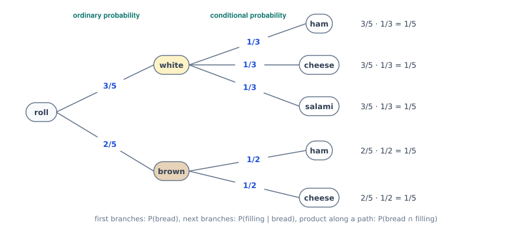
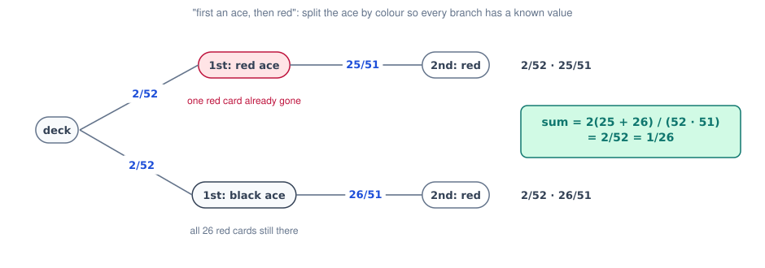
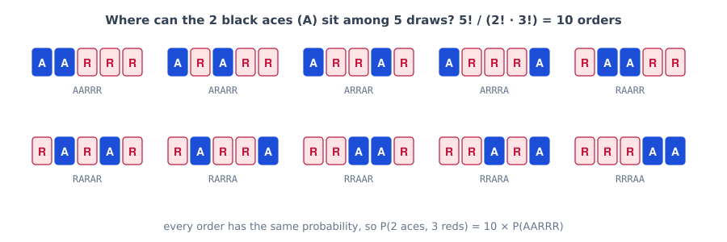

# Probability Trees And Repeated Experiments

A **probability tree** turns the rules from "Probability Foundations" into a picture you can compute with. Instead of juggling formulas for unions, intersections and conditional probabilities, you draw branches, write a probability on each, and follow two simple rules. Trees are especially good at experiments that happen in **stages**, which leads naturally into repeating an experiment several times, with or without putting things back.

---

## Reading A Probability Tree

A tree starts at a single point and splits into one branch per possible outcome. Every branch carries the probability of taking it, and the branches leaving one point always add up to $1$.

### OR Means Add

Rolling a die gives a tree with 6 branches of $\frac{1}{6}$ each. "Rolling an even number" means landing on branch 2 **or** 4 **or** 6. These branches are mutually exclusive, so by the addition rule:

$$P(\text{even}) = P(2) + P(4) + P(6) = \frac{3}{6}$$

**If several branches leaving the same point are favourable, add their probabilities.** Be careful with language here: "even" is never "a 2 **and** a 4 **and** a 6". In mathematics "and" means at the same time, and a single roll cannot show three faces.

### AND Means Multiply

A bag of 3 white rolls (ham, cheese, salami) and 2 brown rolls (ham, cheese). You first see the bread, then open the roll to see the filling, so the tree has two levels.



The first level holds **ordinary** probabilities, $P(\text{white}) = \frac{3}{5}$. The second level holds **conditional** probabilities: once you know the roll is brown, there are only 2 fillings left and salami is impossible, so $P(\text{ham} \mid \text{brown}) = \frac{1}{2}$.

Multiplying two consecutive branches gives $P(A) \cdot P(B \mid A)$, which by the multiplication rule is exactly $P(A \cap B)$. **Multiplying along a path gives the probability of everything on that path happening.** Here every leaf works out to $\frac{1}{5}$, which makes sense: there are 5 rolls, all equally likely.

### The Chain Rule In Tree Form

The tree extends to any number of stages. Along a path $A \to B \to C$, the first branch carries $P(A)$, the second $P(B \mid A)$, the third $P(C \mid A \cap B)$, and

$$P(A) \cdot P(B \mid A) \cdot P(C \mid A \cap B) = P(A \cap B \cap C)$$

You get this formula for free just by multiplying along the path, without writing it out. When stages are **independent**, the conditional probabilities equal the ordinary ones, so the branches simply carry $P(A)$ and $P(B)$.

### Draw Only What You Need

You never need the complete tree. If the question only asks about one combination of outcomes, draw only the path (or paths) leading to it. For large experiments, the full tree would be enormous, so this is not just a shortcut but a necessity.

---

## The Unknown Branch Trap

Some questions produce a branch whose probability you cannot fill in. Two cards are drawn without replacement. What is the probability that the first card is an **ace** and the second is **red**?

The first branch is easy, $\frac{4}{52}$. But the second depends on **which** ace was drawn: a red ace removes a red card from the deck, a black ace does not. The branch value is unknown.

### Split Until Every Branch Is Known

The fix is to split the first stage into cases that do determine the second stage: "red ace" and "black ace". These are mutually exclusive, so you compute both paths and add.



$$P = \frac{2}{52} \cdot \frac{25}{51} + \frac{2}{52} \cdot \frac{26}{51} = \frac{2(25 + 26)}{52 \cdot 51} = \frac{2}{52} = \frac{1}{26}$$

The general lesson: **if a branch probability depends on a detail you have not tracked, split the previous stage on that detail.** Notice the answer equals $P(\text{ace}) \cdot P(\text{red}) = \frac{4}{52} \cdot \frac{26}{52}$, as if the draws were independent. That is a coincidence of the numbers, not a rule, so you still need the split to know it.

---

## Repeating Experiments

Many problems repeat the same basic experiment several times: draw 5 cards, roll 3 dice, send 10 packets. Two questions determine how to compute the probability:

| Question | Options |
|---|---|
| Is the item put back between draws? | **Without replacement** (dependent draws) or **with replacement** (independent draws) |
| Does the question fix the order? | **Order fixed** ("first X, then Y") or **all orders count** ("one X and one Y") |

Rolling dice behaves like drawing **with** replacement: every roll starts from the same situation.

### Without Replacement, Order Fixed

Two cards, no replacement. What is the probability that the first is a **black ace** and the second is **red**? There is only one path:

$$\frac{2}{52} \cdot \frac{26}{51} = \frac{1}{51}$$

The second factor has denominator $51$ because one card is gone.

### Without Replacement, All Orders Count

What is the probability that **one** card is a black ace and **the other** is red? Now two orders qualify: ace then red, or red then ace. Both have the same probability ($\frac{2}{52} \cdot \frac{26}{51} = \frac{26}{52} \cdot \frac{2}{51}$), so the answer is twice the single path:

$$2 \cdot \frac{1}{51} = \frac{2}{51}$$

### Counting The Orders

For 5 cards, what is the probability of 2 black aces (A) and 3 red cards (R)? One specific order, AARRR, has probability

$$P(AARRR) = \frac{2}{52} \cdot \frac{1}{51} \cdot \frac{26}{50} \cdot \frac{25}{49} \cdot \frac{24}{48}$$

Every other order (ARARR, RRRAA, ...) has the same probability: the same numerators and denominators appear, just shuffled. So instead of listing them, **count** them. Placing 2 A's and 3 R's in a row is a permutation with repetition from "Combinatorics":



$$\frac{5!}{2! \cdot 3!} = 10 \qquad\Rightarrow\qquad P(X = 2, Y = 3) = 10 \cdot \frac{2 \cdot 1 \cdot 26 \cdot 25 \cdot 24}{52 \cdot 51 \cdot 50 \cdot 49 \cdot 48} \approx 0.10\%$$

Here $X$ counts black aces and $Y$ counts red cards, and the comma in $P(X = 2, Y = 3)$ means **and**.

The same result comes out of pure counting with Laplace: choose both black aces and 3 of the 26 red cards, out of all 5-card hands.

$$\frac{\binom{2}{2}\binom{26}{3}}{\binom{52}{5}} = \frac{2600}{2\,598\,960} \approx 0.10\%$$

Getting the same answer by two independent methods is a strong check. The counting form is the **hypergeometric** pattern: $\frac{\binom{K}{k}\binom{N-K}{n-k}}{\binom{N}{n}}$ for drawing $k$ "special" items when $n$ are drawn from $N$ containing $K$ special ones.

### With Replacement

Now the card goes back each time, which is the same as drawing from a fresh deck every time. The draws are **independent** and the denominators stay at $52$.

Order fixed, black ace then red:

$$P(AR) = \frac{2}{52} \cdot \frac{26}{52} = \frac{1}{52}$$

All orders count, one black ace and one red: $P(AR) + P(RA) = 2 \cdot \frac{1}{52} = \frac{1}{26}$.

Five draws, 2 black aces and 3 reds:

$$P(X = 2, Y = 3) = \frac{5!}{2! \cdot 3!}\left(\frac{2}{52}\right)^2\left(\frac{26}{52}\right)^3 = 10\left(\frac{2}{52}\right)^2\left(\frac{26}{52}\right)^3$$

With only two kinds of outcome per draw ("success" with probability $p$, "failure" with $1 - p$), this is the **binomial** pattern that comes back later in the course:

$$P(k \text{ successes in } n \text{ independent trials}) = \binom{n}{k} p^k (1-p)^{n-k}$$

### Side By Side

| | Order fixed | All orders count |
|---|---|---|
| **Without replacement** | Multiply along one path, denominators shrink | One path $\times$ number of orders |
| **With replacement** | Multiply along one path, denominators stay | One path $\times$ number of orders |

The structure is identical, only the denominators differ. The "number of orders" is always a permutation with repetition, $\frac{n!}{k_1! \, k_2! \cdots}$.

### Simulating To Check

When you are unsure whether a problem is "with" or "without" replacement, a simulation settles it. `random.sample` draws without replacement, `random.choices` with.

```python
import random

deck = ["BA"] * 2 + ["R"] * 26 + ["O"] * 24          # black aces, reds, others
trials = 1_000_000
hits = sum(1 for _ in range(trials)
           if sorted(random.sample(deck, 2)) == ["BA", "R"])
print(hits / trials, 2 / 51)                          # both about 0.0392
```

---

## Worked Exercises

These are taken from the exercise sets at the end of the probability part of the book.

### Transfer Between Boxes

Box 1 holds 4 white and 3 black balls, box 2 holds 3 white and 5 black. One ball moves from box 1 to box 2, then a ball is drawn from box 2 (now 9 balls). Split on the colour that moved:

$$P(\text{2nd white}) = \frac{4}{7} \cdot \frac{4}{9} + \frac{3}{7} \cdot \frac{3}{9} = \frac{25}{63} \approx 39.7\%$$

$$P(\text{different colours}) = \frac{4}{7} \cdot \frac{5}{9} + \frac{3}{7} \cdot \frac{3}{9} = \frac{29}{63} \approx 46.0\%$$

### Three Children

Each child is a boy or girl with probability $\frac{1}{2}$, independently. At least one girl: $1 - \left(\frac{1}{2}\right)^3 = \frac{7}{8}$. All girls **given** at least one girl: $\frac{1/8}{7/8} = \frac{1}{7}$. Exactly two boys: $\binom{3}{2}\left(\frac{1}{2}\right)^3 = \frac{3}{8}$.

### Drawing Without Replacement

A box with 6 red and 8 white balls; draw 5. $P(3 \text{ red}, 2 \text{ white}) = \frac{\binom{6}{3}\binom{8}{2}}{\binom{14}{5}} = \frac{20 \cdot 28}{2002} \approx 28.0\%$.

5 storage disks, 2 defective, inspect 3: $P(\text{exactly one defective}) = \frac{\binom{2}{1}\binom{3}{2}}{\binom{5}{3}} = \frac{6}{10} = 60\%$.

100 modules of which 20 have bugs, test 5: $P(\text{no bugs}) = \frac{\binom{80}{5}}{\binom{100}{5}} \approx 31.9\%$.

### The Birthday Problem

In a group of 25, the chance that everyone has a different birthday (365 days, equally likely) is a chain of shrinking fractions, the same as drawing without replacement:

$$\frac{365}{365} \cdot \frac{364}{365} \cdots \frac{341}{365} \approx 43.1\% \qquad\Rightarrow\qquad P(\text{shared birthday}) \approx 56.9\%$$

The same structure explains **hash collisions**. Ten keys in a hash table with 100 buckets all land in different buckets with probability $\frac{100 \cdot 99 \cdots 91}{100^{10}} \approx 62.8\%$, so more than a third of the time at least two keys collide, even though the table is only $10\%$ full. Four bus passengers choosing among 10 stops all get off at different stops with probability $\frac{10 \cdot 9 \cdot 8 \cdot 7}{10^4} = 50.4\%$.

### Independent Repetitions

A Bloom filter gives a false positive with probability $0.02$. Over 100 independent queries for absent elements, $P(\text{at least one false positive}) = 1 - 0.98^{100} \approx 86.7\%$.

An ID of 6 random digits contains exactly two zeros with probability $\binom{6}{2}(0.1)^2(0.9)^4 \approx 9.84\%$, a direct binomial calculation.

### Monty Hall

Three doors, one hides a computer. You pick a door, then the host, who knows where the computer is, opens one of the other two doors and shows it is empty. You may now switch. Sticking wins only if your first pick was right: $\frac{1}{3}$. Switching wins whenever your first pick was wrong ($\frac{2}{3}$), because the empty door that was opened leaves the prize behind the remaining one. **Switch**: $P = \frac{2}{3}$.

### A Dice Game

Roll two dice: a sum of 4, 7 or 11 wins, an 8 means "keep rolling until 8 (win) or 7 (lose)", anything else loses. $P(4 \text{ or } 7 \text{ or } 11) = \frac{3 + 6 + 2}{36} = \frac{11}{36}$. After an 8, only 8s and 7s matter, so the chance of hitting 8 first is $\frac{5}{5 + 6} = \frac{5}{11}$. Total: $\frac{11}{36} + \frac{5}{36} \cdot \frac{5}{11} = \frac{146}{396} \approx 36.9\%$.

---

## Quick Recap

- Branches from one point sum to $1$. **First level**: ordinary probabilities. **Later levels**: conditional probabilities.
- **OR**: add the favourable branches. **AND**: multiply along the path (the chain rule for free).
- Draw only the paths you need.
- If a branch value depends on an untracked detail, **split the earlier stage** on that detail.
- **Without replacement**: denominators shrink, draws are dependent. **With replacement**: denominators stay, draws are independent.
- **Order fixed**: one path. **All orders count**: one path $\times$ number of orders $\frac{n!}{k_1! k_2! \cdots}$.
- Counting check: without replacement matches $\frac{\binom{K}{k}\binom{N-K}{n-k}}{\binom{N}{n}}$, with replacement matches $\binom{n}{k}p^k(1-p)^{n-k}$.
