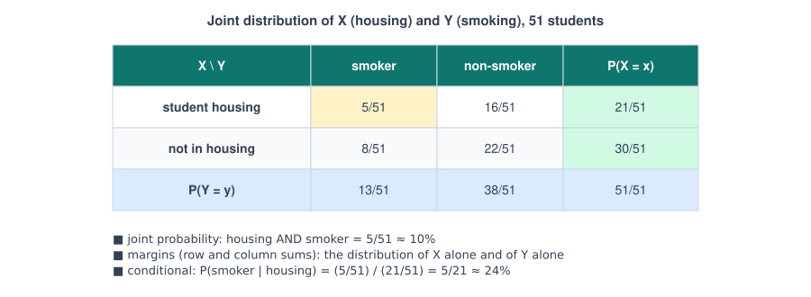

# Random Variables And Joint Distributions

A **stochastic variable** (or **random variable**) is a variable whose value is determined by chance. Roll a die and let $X$ be the number of pips: before the roll you do not know $X$, but you know exactly which values it can take and how likely each one is. Random variables turn outcomes into **numbers**, which is what makes it possible to compute with them, tabulate them, and later build distributions like the binomial and normal distribution on top of them. This note builds on "Probability Foundations".

---

## The Distribution Of One Variable

The **probability distribution** of $X$ lists the probability of every value $X$ can take. Building one is always a two step job:

1. Determine **which values** $X$ can take.
2. Determine **how the probability is divided** over those values.

For "roll a fair die", with $X$ the number of pips:

| $k$ | $1$ | $2$ | $3$ | $4$ | $5$ | $6$ |
|---|---|---|---|---|---|---|
| $P(X = k)$ | $\frac{1}{6}$ | $\frac{1}{6}$ | $\frac{1}{6}$ | $\frac{1}{6}$ | $\frac{1}{6}$ | $\frac{1}{6}$ |

The probabilities in a distribution always add up to $1$, because $X$ must take **some** value. That is the first thing to check in any distribution table you build.

### A Variable Built From Another

Random variables can be computed from other random variables. Pick an input size $n$ uniformly from $\{100, 200, 300, 400, 500\}$ for an algorithm with running time proportional to $n^2$, and let $Y = n^2$ (the running time with the constant factor left out). $Y$ inherits its probabilities from $n$:

| $Y$ | $10\,000$ | $40\,000$ | $90\,000$ | $160\,000$ | $250\,000$ |
|---|---|---|---|---|---|
| $P(Y = y)$ | $\frac{1}{5}$ | $\frac{1}{5}$ | $\frac{1}{5}$ | $\frac{1}{5}$ | $\frac{1}{5}$ |

The values get stretched far apart, but each one keeps the probability of the input that produced it.

---

## Joint Distributions

Often you observe **two** variables at once and care about how they relate. In a survey of 51 students, $X$ is "does the student live in student housing?" and $Y$ is "does the student smoke?". Every student gives a pair of answers $(x_i, y_i)$, such as (not in housing, smoker).

### The Joint Table

Each variable here takes only two values, so there are four combinations. The probability of one combination, such as $P(X = \text{housing}, Y = \text{smoker})$, is a **joint probability** (the comma means **and**). The table of all joint probabilities is the **joint probability distribution** of $X$ and $Y$:

| $X \setminus Y$ | smoker | non-smoker |
|---|---|---|
| **student housing** | $\frac{5}{51}$ | $\frac{16}{51}$ |
| **not in housing** | $\frac{8}{51}$ | $\frac{22}{51}$ |

Interpretation: 5 of the 51 students live in student housing **and** smoke, so a randomly chosen student has about a $10\%$ chance of being a smoker in student housing.

### Marginal Distributions

Add each row and each column and write the sums in the **margins** of the table. The row sums give the distribution of $X$ on its own, the column sums the distribution of $Y$ on its own. That is where the name **marginal distribution** comes from.



| $X \setminus Y$ | smoker | non-smoker | $P(X = x)$ |
|---|---|---|---|
| **student housing** | $\frac{5}{51}$ | $\frac{16}{51}$ | $\frac{21}{51}$ |
| **not in housing** | $\frac{8}{51}$ | $\frac{22}{51}$ | $\frac{30}{51}$ |
| $P(Y = y)$ | $\frac{13}{51}$ | $\frac{38}{51}$ | $\frac{51}{51}$ |

So about $\frac{21}{51} \approx 41\%$ of the students live in student housing. In general, if $Y$ takes values $y_1, \dots, y_m$ and $X$ takes $x_1, \dots, x_n$:

$$P(X = x_i) = \sum_{j=1}^{m} P(X = x_i, Y = y_j) \qquad\qquad P(Y = y_j) = \sum_{i=1}^{n} P(X = x_i, Y = y_j)$$

This works because the rows split the event "$X = x_i$" into mutually exclusive pieces, one per value of $Y$, and mutually exclusive pieces add.

### Conditional Probabilities From A Table

What is the probability that a student smokes, **given** that they live in student housing? The condition restricts you to the housing **row**. There are two equivalent ways to compute it.

With **counts** (Laplace inside the row): $\frac{\text{housing and smoker}}{\text{housing}} = \frac{5}{21} \approx 24\%$.

With **probabilities** only (the definition of conditional probability):

$$P(\text{smoker} \mid \text{housing}) = \frac{P(\text{housing} \cap \text{smoker})}{P(\text{housing})} = \frac{5/51}{21/51} = \frac{5}{21}$$

The rule of thumb: **a condition on $X$ means divide by a row total, a condition on $Y$ means divide by a column total.**

---

## Independent Random Variables

For events, independence means $P(A \cap B) = P(A) \cdot P(B)$. Applied to every cell of the table, this gives the definition for random variables: $X$ and $Y$ are **independent** if and only if

$$P(X = x_i, Y = y_j) = P(X = x_i) \cdot P(Y = y_j) \quad \text{for every } i \text{ and } j$$

Every cell must equal its row margin times its column margin. **One** cell that fails is enough to conclude that $X$ and $Y$ are **dependent**. To prove independence, you have to check **all** cells.

### Checking A Table

The joint distribution below has margins $P(X = 2) = 0.20$, $P(X = 5) = 0.50$, $P(X = 7) = 0.30$ and $P(Y = 1) = 0.30$, $P(Y = 2) = 0.30$, $P(Y = 3) = 0.20$, $P(Y = 4) = 0.20$.

| $X \setminus Y$ | $1$ | $2$ | $3$ | $4$ |
|---|---|---|---|---|
| $2$ | $0.06$ | $0.06$ | $0.04$ | $0.04$ |
| $5$ | $0.15$ | $0.12$ | $0.10$ | $0.13$ |
| $7$ | $0.09$ | $0.12$ | $0.06$ | $0.03$ |

The whole first row matches ($0.20 \cdot 0.30 = 0.06$, $0.20 \cdot 0.20 = 0.04$), and so does the first cell of the second row. But $P(X = 5, Y = 2) = 0.12$ while $0.50 \cdot 0.30 = 0.15$. So $X$ and $Y$ are **not** independent. The first few matching cells prove nothing.

### Building An Independent Table

To construct an independent joint distribution yourself, pick any two marginal distributions and fill every cell with the product of its margins. Rolling two dice is the standard example: every cell is $\frac{1}{6} \cdot \frac{1}{6} = \frac{1}{36}$.

### Computing Tables In Code

With raw survey data, `pandas` builds the joint table and margins in one call. `normalize="all"` divides every count by the total, which turns counts into joint probabilities.

```python
import pandas as pd

df = pd.DataFrame({
    "housing": ["yes"] * 21 + ["no"] * 30,
    "smoker":  ["yes"] * 5 + ["no"] * 16 + ["yes"] * 8 + ["no"] * 22,
})

joint = pd.crosstab(df["housing"], df["smoker"], normalize="all", margins=True)
print(joint.round(3))

# conditional distribution of smoking within each housing row
print(pd.crosstab(df["housing"], df["smoker"], normalize="index"))
```

---

## Comparing Groups

Joint tables answer questions like "are female students more careful cyclists than male students?". The key is to compare **conditional** probabilities (relative frequencies within each group), never raw counts.

### Bicycle Accidents

$X$ = number of bicycle accidents, $Y$ = gender:

| $X \setminus Y$ | male | female | $P(X = x)$ |
|---|---|---|---|
| **0 accidents** | $\frac{6}{51}$ | $\frac{29}{51}$ | $\frac{35}{51}$ |
| **1 accident** | $\frac{5}{51}$ | $\frac{6}{51}$ | $\frac{11}{51}$ |
| **2 accidents** | $\frac{1}{51}$ | $\frac{3}{51}$ | $\frac{4}{51}$ |
| **3 accidents** | $\frac{1}{51}$ | $0$ | $\frac{1}{51}$ |
| $P(Y = y)$ | $\frac{13}{51}$ | $\frac{38}{51}$ | $\frac{51}{51}$ |

The raw counts for one accident (5 men, 6 women) suggest women have more accidents. But there are only 13 men and 38 women, so condition on the column:

| | male | female |
|---|---|---|
| $P(0 \text{ accidents} \mid \text{gender})$ | $\frac{6}{13} \approx 46\%$ | $\frac{29}{38} \approx 76\%$ |
| $P(1 \text{ accident} \mid \text{gender})$ | $\frac{5}{13} \approx 38.5\%$ | $\frac{6}{38} \approx 15.8\%$ |

Relative to their group size, the women in this sample had clearly fewer accidents.

### Small Groups Are Fragile

Be careful with conclusions from small groups. One extra or one fewer man in a cell changes the male percentage by $\frac{1}{13}$, almost 8 percentage points. For women it changes by only $\frac{1}{38}$, about 3 points. Percentages computed from small groups jump around a lot, which is the intuition behind statistical uncertainty and confidence intervals.

### Motivation

A second question from the same survey: do students study because it is necessary for their future, or because they enjoy it?

| $X \setminus Y$ | male | female | $P(X = x)$ |
|---|---|---|---|
| **necessary** | $\frac{8}{51}$ | $\frac{4}{51}$ | $\frac{12}{51}$ |
| **enjoy it** | $\frac{5}{51}$ | $\frac{34}{51}$ | $\frac{39}{51}$ |
| $P(Y = y)$ | $\frac{13}{51}$ | $\frac{38}{51}$ | $\frac{51}{51}$ |

$P(\text{enjoy} \mid \text{male}) = \frac{5}{13} \approx 38\%$ versus $P(\text{enjoy} \mid \text{female}) = \frac{34}{38} \approx 89\%$. In this group the answers depend strongly on gender, so the two variables are clearly not independent.

---

## Worked Exercises

These come from the joint distribution exercises in the book.

### Motivation And Housing

| $X \setminus Y$ | housing | not in housing | $P(X = x)$ |
|---|---|---|---|
| **must** | $13\%$ | $36\%$ | $49\%$ |
| **enjoys studying** | $21\%$ | $30\%$ | $51\%$ |
| $P(Y = y)$ | $34\%$ | $66\%$ | $100\%$ |

$P(\text{enjoys} \mid \text{housing}) = \frac{21}{34} \approx 61.8\%$ and $P(\text{enjoys} \mid \text{not in housing}) = \frac{30}{66} \approx 45.5\%$. The conditional probabilities differ, so motivation and housing are related in this data.

### Vaccine Side Effects

77 staff members: 15 men and 6 women report side effects, 40 men and 16 women do not. The margins are 55 men, 22 women, 21 with and 56 without side effects.

$P(\text{side effects}) = \frac{21}{77} = \frac{3}{11}$, $P(\text{side effects} \mid \text{man}) = \frac{15}{55} = \frac{3}{11}$, $P(\text{side effects} \mid \text{woman}) = \frac{6}{22} = \frac{3}{11}$. All three are equal, so gender and side effects are **independent** here. Checking every cell confirms it, for example $\frac{15}{77} = \frac{55}{77} \cdot \frac{21}{77}$.

Given that someone had side effects, the probability that it is a woman is $\frac{6}{21} = \frac{2}{7} \approx 28.6\%$, simply the share of women in the population, as independence predicts.

---

## Quick Recap

- A **random variable** assigns a number to each outcome; its value is determined by chance.
- Its **distribution** lists every value with its probability: first the values, then the probabilities. They sum to $1$.
- A **joint distribution** tabulates $P(X = x_i, Y = y_j)$ for every pair; the comma means **and**.
- **Marginal distributions** are the row and column sums.
- **Conditional** from a table: divide the cell by its row total (condition on $X$) or column total (condition on $Y$).
- **Independent** means **every** cell equals row margin $\times$ column margin; one failing cell means dependent.
- Compare groups with **conditional percentages**, not raw counts, and distrust percentages from small groups.
